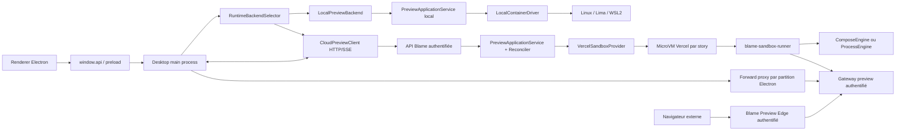

# Spécification — runtime de preview multi-provider avec Vercel Sandbox

**Statut :** spécification d’implémentation  
**Date de référence :** 2 août 2026  
**Périmètre :** Blame Desktop, API Blame, agent runtime, preview runtime et infrastructure Vercel  
**Décision attendue :** implémenter le profil `vercel-compose` derrière un contrat multi-runtime, conserver intégralement le profil local Linux/Lima/WSL, puis ajouter `vercel-process` sans réécrire l’orchestrateur.

---

## 1. Résumé de la décision

Blame doit prendre en charge plusieurs profils d’exécution explicites :

| Profil            | Environnement            | Moteur de services                                     | Statut cible                            |
| ----------------- | ------------------------ | ------------------------------------------------------ | --------------------------------------- |
| `local-container` | machine de l’utilisateur | nerdctl sous Linux, Lima sous macOS, WSL2 sous Windows | conservé, sans régression               |
| `vercel-compose`  | Vercel Sandbox           | Docker Engine et Compose imbriqués dans la microVM     | premier profil cloud à livrer           |
| `vercel-process`  | Vercel Sandbox           | processus lancés directement dans la microVM           | second profil, prévu par l’architecture |
| `vercel-hybrid`   | Vercel Sandbox           | processus applicatifs + dépendances conteneurisées     | extension future, hors V1               |

Le choix ne doit pas devenir un booléen `useVercel`. Il doit être représenté par un profil extensible et par des capacités déclarées.

La localisation du worktree, de Cline et de la preview est un contrat explicite du profil :

| Profil                              | Linux                          | macOS                                     | Windows                                     | Preview                   |
| ----------------------------------- | ------------------------------ | ----------------------------------------- | ------------------------------------------- | ------------------------- |
| `local-container`                   | worktree et Cline natifs Linux | worktree et Cline dans Lima               | worktree et Cline dans WSL2                 | conteneurs locaux isolés  |
| `vercel-compose` / `vercel-process` | worktree et Cline natifs Linux | worktree et Cline natifs macOS, sans Lima | worktree et Cline natifs Windows, sans WSL2 | Vercel Sandbox uniquement |

Le profil cloud ne démarre, ne préchauffe et ne sonde donc jamais Lima, WSL2, nerdctl ou un Compose local. Le backend Cline reste sur le host et Vercel ne reçoit qu’une réplique d’exécution du worktree natif.

Une story cloud possède une microVM Vercel distincte. Les ports internes peuvent donc rester fixes : deux stories peuvent toutes les deux utiliser `localhost:3000` et `localhost:3333` sans collision entre elles. Un proxy n’a pas à modifier le port sur lequel un processus écoute ; il publie un autre point d’entrée vers ce port.

La solution Vercel ne remplace pas le mode local. Les projets existants restent en local et aucun code ne doit être envoyé dans le cloud sans consentement explicite.

### Décisions structurantes

1. Le `PreviewManifest` reste la source canonique de l’intention d’exécution. Compose devient un artefact compilé pour un driver donné.
2. Le token Vercel de Blame reste exclusivement dans un control plane serveur. Il n’est jamais livré à Electron ni à une sandbox.
3. L’image OCI personnalisée fournit le root filesystem de la microVM. Docker Compose est une seconde couche, imbriquée dans cette microVM.
4. Le mode cloud V1 réutilise Compose pour minimiser le risque de migration, mais cette dépendance reste derrière un moteur d’exécution remplaçable.
5. Les références `localhost` sont traitées à deux endroits différents :
   - SSR et appels serveur-à-serveur : réseau partagé ou relay dans la sandbox ;
   - appels navigateur client-side : forward proxy isolé dans la partition Electron de la story.
6. Une URL `sandbox.domain(port)` est considérée publique. Tous les ports exposés passent par un gateway Blame authentifié.
7. Le worktree natif et Cline restent l’autorité du code en profil cloud. La sandbox est une réplique d’exécution rafraîchie avant chaque démarrage ou redémarrage de preview ; ses écritures générées ne sont jamais appliquées automatiquement au worktree.
8. Aucun nouveau fichier de production ne dépasse 1 000 lignes ; la cible est de 300 à 600 lignes. Les deux monolithes actuels sont découpés pendant la migration.

---

## 2. Contexte et problèmes à résoudre

### 2.1 Comportement actuel recherché

Pour chaque user story, Blame :

- crée un worktree Git isolé ;
- initialise automatiquement l’environnement, les variables et les dépendances ;
- démarre les services du projet ;
- isole les ports pour permettre plusieurs previews concurrentes ;
- affiche une preview intégrée ;
- conserve un diff local permettant revue, commit et merge.

Le runtime actuel place les services dans des conteneurs. Sous Linux, il s’appuie directement sur le runtime local. Sous macOS et Windows, il nécessite respectivement Lima et WSL2.

Ce modèle est fonctionnel, mais l’installation et le coût machine de la virtualisation sont lourds. Le profil Vercel doit déplacer l’exécution non fiable hors du poste tout en conservant le comportement produit.

### 2.2 Pourquoi un simple reverse proxy local ne suffit pas

Un reverse proxy peut exposer `5001 -> 3000`, mais il ne change pas le port sur lequel le processus cible écoute.

Si deux processus non isolés essaient tous les deux de binder `127.0.0.1:3000` sur le même OS, le second échoue avant que le proxy puisse intervenir. Il faut alors :

- changer le port du processus ;
- ou lui donner un namespace réseau distinct ;
- ou l’exécuter dans une VM distante distincte.

Vercel Sandbox fournit précisément ce dernier niveau d’isolation : chaque story obtient sa propre microVM et peut conserver ses ports logiques.

### 2.3 Le cas frontend/backend avec ports hardcodés

Exemple :

```text
frontend : localhost:3000
backend  : localhost:3333
```

Deux problèmes différents existent :

- un `fetch("http://localhost:3333")` exécuté dans Chromium vise normalement le PC de l’utilisateur ;
- un appel SSR vers `localhost:3333` vise le namespace réseau du processus frontend.

Le proxy Electron ne peut résoudre que le premier. Le second doit être résolu dans la sandbox.

### 2.4 Docker Compose ne garantit pas la sémantique localhost

Deux conteneurs Compose distincts possèdent normalement deux namespaces réseau :

```text
frontend container -> localhost:3333
```

vise le conteneur frontend et non le backend.

Le conteneur n’est donc pas, à lui seul, la solution aux URLs SSR hardcodées. Le driver cloud doit mettre en place un namespace partagé, un relay loopback ciblé ou des processus natifs.

### 2.5 Limites du navigateur externe

Le navigateur système n’utilise pas la partition ni le proxy réseau de Blame. Un projet dont le JavaScript client appelle un `localhost` hardcodé ne peut donc être garanti que dans la preview intégrée.

Le produit doit distinguer :

- une preview standard, ouvrable dans Blame et dans un navigateur externe ;
- une preview en mode de compatibilité `localhost`, disponible uniquement dans Blame avec une explication claire.

---

## 3. Objectifs

### 3.1 Objectifs fonctionnels

- Exécuter setup, commandes, tests, frontend, backend, workers et dépendances d’une story dans une Vercel Sandbox.
- Permettre plusieurs stories simultanées utilisant les mêmes ports logiques.
- Préserver les références SSR hardcodées à `localhost` quand la topologie n’est pas ambiguë.
- Préserver les références client-side hardcodées à `localhost` dans la preview Electron.
- Garder l’ouverture dans un navigateur externe pour les projets compatibles.
- Conserver intégralement Linux natif, Lima et WSL2.
- Synchroniser sans perte chaque révision du worktree natif vers sa réplique cloud, sans jamais écraser automatiquement le worktree depuis la sandbox.
- Suspendre, reprendre et supprimer une session de façon idempotente.
- Appliquer sécurité, quotas, anti-abus, expiration et plafonds de coût côté serveur.
- Donner à l’utilisateur, à terme, le choix du profil globalement, par projet et par story.

### 3.2 Objectifs d’architecture

- Un cœur métier sans dépendance Electron, Vercel, nerdctl, Lima ou WSL.
- Des drivers remplaçables et testés par une même suite de contrats.
- Un control plane persistant et réconciliable après crash.
- Des contrats versionnés entre desktop, API et runner.
- Des handlers IPC minces, enregistrés depuis `packages/desktop/src/main/ipc.ts`.
- Aucun conditionnel Vercel ajouté dans `workspace-ipc.ts` ou `container-runtime.ts`.
- Des limites de taille de fichier contrôlées par CI.

### 3.3 Non-objectifs

- Déployer le projet de l’utilisateur en production.
- Supprimer ou déprécier le mode local.
- Basculer automatiquement du cloud vers le local en cas d’erreur.
- Migrer une session active d’un provider à l’autre.
- Garantir en V1 HTTPS sur un hostname `localhost`, WebRTC, UDP, QUIC ou des protocoles TCP arbitraires.
- Fournir un navigateur externe compatible avec du `localhost` client-side hardcodé.
- Exposer directement le socket Docker ou les credentials Vercel.
- Donner automatiquement au cloud accès aux services, fichiers ou réseaux privés du PC.
- Construire un cloud auto-hébergé Blame dans cette version.

---

## 4. État du dépôt et points d’insertion

Les fondations existantes à conserver sont :

- `packages/preview-contract/src/types.ts` : services, endpoints, bindings, probes et caches ;
- `packages/preview-contract/src/parser.ts` : validation du manifeste ;
- `packages/agent-runtime/src/preview-manifest.ts` : compilation actuelle vers Compose ;
- `packages/desktop/src/main/container-runtime.ts` : abstraction nerdctl/Lima/WSL ;
- `packages/desktop/src/main/runtime-manager.ts` et `workspace-runtime.ts` : gestion locale ;
- `packages/desktop/src/main/preview-run-state.ts` : sélection de configuration ;
- `packages/desktop/src/main/preview-browser-partition.ts` : partition Electron distincte par story ;
- `packages/desktop/src/main/cline-backend-resolver.ts` : point d’insertion d’un backend agent distant.

Les monolithes à découper sont :

| Fichier au 2 août 2026                           | Lignes | Problème                                                              |
| ------------------------------------------------ | -----: | --------------------------------------------------------------------- |
| `packages/desktop/src/main/workspace-ipc.ts`     |  5 184 | mélange IPC, Git, worktree, Compose, logs, probes, état et télémétrie |
| `packages/agent-runtime/src/cline-runtime.ts`    |  5 005 | mélange orchestration agent, outils et intégrations d’exécution       |
| `packages/desktop/src/main/workspace-compose.ts` |  1 326 | transformations Compose trop concentrées                              |
| `packages/desktop/src/main/workspace-runtime.ts` |  1 035 | proche de la future limite dure                                       |

La feature Vercel ne doit ajouter aucune ligne aux deux fichiers de plus de 5 000 lignes, hors suppression ou code transitoire qui réduit leur taille dans le même changement.

---

## 5. Modèle métier multi-runtime

### 5.1 Profils

```ts
export type RuntimeProfileId =
  | "local-container"
  | "vercel-compose"
  | "vercel-process";

export type LocalRuntimeBackend = "linux-native" | "lima" | "wsl2";
```

Le backend local est une propriété du profil local, pas un profil produit distinct. Le renderer ne reçoit pas les identifiants bruts du provider.

### 5.2 Capacités

```ts
export type RuntimeCapabilities = {
  dockerCompose: boolean;
  nativeProcesses: boolean;
  sharedLoopback: boolean;
  snapshots: boolean;
  persistentFilesystem: boolean;
  publicHttpIngress: boolean;
  webSockets: boolean;
  networkPolicy: boolean;
  credentialBroker: boolean;
  bidirectionalSync: boolean;
  maxPublishedPorts?: number;
};
```

Le planner valide le manifeste contre les capacités avant tout provisioning. Il retourne soit un plan, soit une liste d’incompatibilités typées et compréhensibles par l’UI.

### 5.3 Contrat du driver

Créer `packages/preview-runtime`, sans dépendance de plateforme :

```text
packages/preview-runtime/src/
  domain/
    runtime-profile.ts
    runtime-capabilities.ts
    execution-plan.ts
    preview-session.ts
    endpoint-map.ts
    preview-errors.ts
  application/
    preview-orchestrator.ts
    preview-reconciler.ts
    preview-commands.ts
  compilation/
    manifest-compiler.ts
    capability-resolver.ts
  ports/
    preview-runtime-driver.ts
    session-repository.ts
    source-transport.ts
    preview-event-sink.ts
    distributed-lock.ts
```

Le desktop consomme un backend de session sérialisable :

```ts
export interface PreviewSessionBackend {
  create(input: CreatePreviewSessionInput): Promise<PreviewSessionView>;
  command(
    sessionId: string,
    command: PreviewSessionCommand,
    operationId: string,
  ): Promise<PreviewSessionView>;
  get(sessionId: string): Promise<PreviewSessionView>;
  events(
    sessionId: string,
    cursor?: string,
  ): AsyncIterable<PreviewSessionEvent>;
}

type PreviewSessionCommand =
  | { type: "start-services"; configurationId: string }
  | { type: "stop-services" }
  | { type: "start-agent" }
  | { type: "stop-agent" }
  | { type: "suspend-host" }
  | { type: "resume-host" }
  | {
      type: "destroy-host";
      discardPendingDelta?: { confirmationId: string };
    }
  | { type: "ack-local-sync"; deltaRevision: string };
```

- `LocalPreviewBackend` héberge l’application et le reconciler en processus dans Electron.
- `CloudPreviewClient` implémente ce contrat par HTTP/SSE vers l’API.
- Seuls des DTO sérialisables franchissent IPC et HTTP.
- Un `RuntimeHandle`, un SDK Vercel ou une commande provider ne franchit jamais ces frontières.

À l’intérieur du processus qui héberge le reconciler — desktop pour local, API pour cloud — le driver provider expose :

```ts
export interface PreviewRuntimeDriver {
  readonly profile: RuntimeProfileId;

  capabilities(plan: PreviewExecutionPlan): Promise<CapabilityReport>;
  provisionHost(input: ProvisionInput): Promise<RuntimeHandle>;
  resumeHost(handle: RuntimeHandle): Promise<void>;
  syncIn(handle: RuntimeHandle, source: SourceArtifact): Promise<SyncReceipt>;
  prepareEngine(
    handle: RuntimeHandle,
    plan: PreviewExecutionPlan,
  ): Promise<void>;
  startServices(
    handle: RuntimeHandle,
    selection: RuntimeSelection,
  ): Promise<void>;
  stopServices(handle: RuntimeHandle): Promise<void>;
  exec(handle: RuntimeHandle, input: ExecInput): Promise<ExecResult>;
  inspect(handle: RuntimeHandle): Promise<RuntimeObservation>;
  endpoints(handle: RuntimeHandle): Promise<EndpointMap>;
  logs(input: LogRequest): AsyncIterable<PreviewLogEvent>;
  exportDelta(
    handle: RuntimeHandle,
    revision: string,
  ): Promise<DurableDeltaReceipt>;
  suspendHost(handle: RuntimeHandle): Promise<SuspendReceipt>;
  destroyHost(handle: RuntimeHandle): Promise<DestroyReceipt>;
  usage(handle: RuntimeHandle): Promise<RuntimeUsage>;
}
```

`RuntimeHandle` est opaque et reste dans le repository du reconciler. L’orchestrateur ne branche jamais sur un sandbox ID Vercel.

Le driver est lui-même composé de ports plus petits :

```ts
interface ExecutionHost {
  exec(input: ExecInput): Promise<ExecResult>;
  writeFiles(files: RuntimeFile[]): Promise<void>;
  readFiles(paths: string[]): Promise<RuntimeFile[]>;
}

interface PreviewExecutionEngine {
  prepare(context: EngineContext, plan: PreviewExecutionPlan): Promise<void>;
  startServices(context: EngineContext): Promise<void>;
  stopServices(context: EngineContext): Promise<void>;
  inspect(context: EngineContext): Promise<RuntimeObservation>;
}
```

Le renderer Compose et ses validations sont partagés. `LocalExecutionHost` utilise nerdctl/Lima/WSL ; `VercelExecutionHost` passe par le runner. Les particularités provider restent aux bords.

### 5.4 Plan d’exécution

Le `PreviewManifest` reste l’intention canonique. Un compilateur produit un `PreviewExecutionPlan` indépendant du provider :

```ts
export type PreviewExecutionPlan = {
  version: 1;
  workspaceRoot: "/workspace";
  setup: SetupTaskPlan[];
  services: ServiceLaunchPlan[];
  caches: CachePlan[];
  probes: ProbePlan[];
  networking: NetworkPlan;
  detectedCompatibility: CompatibilityRequirement[];
};
```

Compose, les commandes directes et les relays sont générés depuis ce plan.

Ne pas casser immédiatement les manifestes V1/V2 dont `image` est obligatoire. Ajouter d’abord le plan normalisé interne. Une future version du manifeste pourra accepter :

```ts
type ServiceExecutionSource =
  | { kind: "container"; image: string }
  | { kind: "process"; toolchain?: string }
  | { kind: "auto"; image?: string };
```

Cette évolution doit être versionnée et migrée par le parser.

### 5.5 Versionnement des protocoles

Le contrat desktop/API et le contrat API/runner sont versionnés indépendamment :

```ts
type RuntimeProtocolHandshake = {
  protocolVersion: number;
  runnerVersion: string;
  imageDigest: string;
  capabilities: RuntimeCapabilities;
};
```

- Le runner annonce ses capacités au démarrage.
- Le control plane refuse une version incompatible avec une erreur typée.
- Une image n’est promue qu’avec la suite de contract tests de sa version.
- Les champs ajoutés sont optionnels tant que tous les clients supportés n’ont pas migré.
- La DB conserve version du plan, version du protocole et digest de l’image pour rendre un incident reproductible.

---

## 6. Architecture globale



### 6.1 Frontière de confiance

Sont de confiance :

- le desktop main process ;
- l’API/control plane Blame ;
- le binaire d’orchestration de l’agent et les credentials modèle, lorsqu’ils restent hors sandbox ;
- le reconciler et le reaper.

Ne sont pas de confiance :

- le dépôt utilisateur ;
- les dépendances installées ;
- les commandes générées par l’agent ;
- les serveurs de développement ;
- les conteneurs Compose ;
- tout processus de projet dans la sandbox.

Dans les profils Vercel V1, seuls les services de preview, leurs dépendances et leurs commandes de démarrage s’exécutent à distance. Cline, ses outils shell/fichier et les tests qu’il lance restent sur le host dans le worktree natif. Cette décision conserve le modèle de confiance actuel de l’agent local ; elle ne prétend pas isoler du poste les commandes de Cline.

La sandbox ne reçoit ni credential modèle ni backend Cline. Ses capabilities sont limitées au démarrage des services, au gateway, aux logs et à l’import de la réplique de workspace. Un futur profil d’agent distant devra définir un `WorkspaceExecutor` et un modèle de confiance séparés.

---

## 7. Control plane Blame

### 7.1 Règle P0

Le token Vercel de Blame ne doit jamais être présent :

- dans le renderer ;
- dans le preload ;
- dans le main process Electron ;
- dans les logs desktop ;
- dans la sandbox ;
- dans une archive de workspace ;
- dans un snapshot.

En mode géré, Electron appelle l’API Blame, qui détient les credentials Vercel et applique autorisations, quotas, leases, budgets et audit.

Si l’API est déployée sur Vercel, utiliser OIDC. Si elle est hébergée ailleurs, utiliser un access token serveur restreint, stocké dans le secret manager. Un futur mode BYO Vercel peut conserver le token utilisateur dans le trousseau système, mais il est hors périmètre V1.

### 7.2 Modules API

```text
packages/api/app/
  controllers/
    preview_sessions_controller.ts
  models/
    preview_session.ts
    preview_operation.ts
  services/preview_sessions/
    preview_session_service.ts
    preview_reconciler.ts
    preview_session_repository.ts
    preview_quota_service.ts
    preview_lease_service.ts
    preview_reaper.ts
  services/sandboxes/
    sandbox_provider.ts
    vercel_sandbox_provider.ts
    vercel_compose_engine.ts
    vercel_process_engine.ts
    vercel_network_policy.ts
    vercel_usage_service.ts
  services/workspace_artifacts/
    source_artifact_service.ts
    source_artifact_validator.ts
  services/preview_gateway/
    preview_access_ticket_service.ts
    preview_bridge_ticket_service.ts
    preview_edge_route_service.ts
```

Tous les imports de `@vercel/sandbox` restent dans l’adapter Vercel.

Déployer séparément le proxy d’entrée :

```text
packages/preview-edge/src/
  preview-request-handler.ts
  preview-route-resolver.ts
  preview-session-auth.ts
  upstream-capability-signer.ts
  websocket-forwarder.ts
```

Preview Edge ne reçoit jamais de code projet. Il valide la session Blame, résout une route opaque, signe l’appel interne et limite le trafic. Sa capacité HTTP streaming/WebSocket doit être prouvée par le spike avant de choisir sa plateforme de déploiement.

### 7.3 API indicative

```text
POST   /api/v1/preview-sessions
GET    /api/v1/preview-sessions/:id
POST   /api/v1/preview-sessions/:id/actions
POST   /api/v1/preview-sessions/:id/source/import
POST   /api/v1/preview-sessions/:id/source/export
GET    /api/v1/preview-sessions/:id/logs?cursor=...
GET    /api/v1/preview-sessions/:id/events
POST   /api/v1/preview-sessions/:id/access-ticket
POST   /api/v1/preview-sessions/:id/bridge-ticket
```

Chaque mutation :

- reçoit un `operationId` ou une clé d’idempotence ;
- vérifie user, organisation, projet et story ;
- vérifie le budget et les quotas ;
- prend un lock/fencing token par session ;
- retourne l’état durable, pas seulement le résultat de l’appel provider.

L’API peut utiliser SSE pour les événements et logs. Le protocole doit supporter une reprise par curseur.

### 7.4 Modèle persistant

`preview_sessions` doit au minimum conserver :

```ts
type PreviewSessionRecord = {
  id: string;
  userStoryId: string;
  ownerUserId: string;
  profile: RuntimeProfileId;
  desired: {
    host: "active" | "suspended" | "destroyed";
    services: "running" | "stopped";
    preview: "open" | "closed";
    agent: "running" | "idle";
  };
  state: {
    host: HostState;
    engine: EngineState;
    preview: PreviewState;
    agent: AgentState;
    sync: SyncState;
  };
  revision: number;
  generation: number;
  providerHandleEncrypted?: string;
  planHash: string;
  sourceRevision?: string;
  lastExportedJournalRevision?: string;
  lastAppliedLocalRevision?: string;
  pendingDeltaArtifactId?: string;
  endpointMapEncrypted?: string;
  resourceSize: { vcpus: number; memoryGb: number };
  lastActivityAt: string;
  leaseExpiresAt?: string;
  idleDeadlineAt?: string;
  createdAt: string;
  stoppedAt?: string;
  failure?: PreviewFailure;
};
```

Les opérations et échantillons d’usage sont stockés séparément. Ne pas gonfler une ligne JSON unique avec un historique illimité.

---

## 8. Machine à états et récupération

```ts
type HostState =
  | "unprovisioned"
  | "provisioning"
  | "running"
  | "suspending"
  | "suspended"
  | "resuming"
  | "destroying"
  | "destroyed"
  | "failed";

type EngineState =
  | "idle"
  | "preparing"
  | "starting"
  | "running"
  | "stopping"
  | "stopped"
  | "failed";

type PreviewState = "closed" | "opening" | "ready" | "degraded" | "closing";
type AgentState = "idle" | "starting" | "running" | "stopping" | "failed";
type SyncState =
  | "clean"
  | "importing"
  | "exporting"
  | "pending_local_sync"
  | "applying"
  | "conflict"
  | "failed"
  | "discarded";
```

Ces axes sont orthogonaux : l’agent natif peut travailler alors que la preview distante tourne, et le host peut être suspendu avec un artefact d’audit distant en attente de diagnostic ou de suppression. Cet artefact n’est jamais appliqué automatiquement au worktree. Une `phase` lisible par l’UI peut être dérivée, mais ne constitue pas la source de vérité.

Les commandes modifient seulement l’axe désiré concerné. Un reconciler converge vers cet état. Les opérations sont nommées sans ambiguïté :

- `stopServices()` arrête Compose/processus sans suspendre la microVM ;
- `suspendHost()` exporte l’état durable puis arrête la session de compute ;
- `resumeHost()` redémarre une session depuis le snapshot ;
- `destroyHost()` supprime définitivement les ressources provider après sync ou abandon explicite.

Il ne faut pas modéliser le lifecycle comme une suite d’appels cachée dans un handler IPC.

Exigences :

- transitions idempotentes ;
- révision optimiste ;
- génération/fencing pour ignorer les réponses tardives ;
- retry sans double création ;
- reprise après crash du desktop ou du worker API ;
- compensation après provisioning partiel ;
- relecture de l’état réel Vercel ;
- suppression des ressources orphelines par un sweeper ;
- erreurs typées, code provider et correlation ID conservés pour le support ;
- aucun fallback cloud vers local sans consentement explicite.

Cas à traiter :

- sandbox inexistante ou snapshot expiré ;
- `SANDBOX_SNAPSHOTTING` pendant une commande ;
- image OCI ou pull privé indisponible ;
- `dockerd` non prêt ;
- healthcheck en échec ;
- URL/route recalculée après reprise ;
- 429, timeout et panne Vercel ;
- quota ou budget atteint ;
- stop ou snapshot partiellement réussi.

### Taxonomie d’erreurs

Le cœur expose des codes stables, indépendants du provider :

```ts
type PreviewFailureCode =
  | "INVALID_MANIFEST"
  | "UNSUPPORTED_CAPABILITY"
  | "PROVIDER_AUTH"
  | "PROVIDER_QUOTA"
  | "PROVISION_FAILED"
  | "SOURCE_SYNC_FAILED"
  | "SYNC_CONFLICT"
  | "ENGINE_START_FAILED"
  | "ENDPOINT_NOT_LISTENING"
  | "HEALTHCHECK_FAILED"
  | "PREVIEW_ACCESS_DENIED"
  | "BUDGET_EXCEEDED"
  | "PROVIDER_UNAVAILABLE"
  | "INTERNAL";
```

Une erreur peut conserver un `providerCode` et un `correlationId` non sensibles pour le support. L’UI ne reçoit ni stack serveur, ni token, ni handle provider.

---

## 9. Runner et image OCI Vercel

### 9.1 Contraintes provider à encoder

Valeurs documentées au 2 août 2026 :

| Contrainte Vercel Sandbox       |                              Valeur |
| ------------------------------- | ----------------------------------: |
| durée par défaut                |                           5 minutes |
| durée maximale Hobby            |                          45 minutes |
| durée maximale Pro/Enterprise   |                           24 heures |
| ports publiés                   |                          15 maximum |
| ressources par défaut           |                       2 vCPU / 4 Go |
| ressources maximales Hobby      |                       4 vCPU / 8 Go |
| ressources maximales Pro        |                      8 vCPU / 16 Go |
| ressources maximales Enterprise |                     32 vCPU / 64 Go |
| ratio mémoire                   |                       2 Go par vCPU |
| filesystem snapshotable         |                       jusqu’à 32 Go |
| sandboxes concurrentes Pro      |                2 000 par équipe Pro |
| région disponible               |                  `iad1`, États-Unis |
| expiration snapshot par défaut  | 30 jours après dernière utilisation |

Les quotas du compte Vercel ne remplacent pas les quotas Blame par tenant. Le driver doit aussi respecter les rate limits du control plane Vercel et appliquer un backoff avec jitter.

Ces valeurs datées ne deviennent pas des constantes du cœur. L’adapter épingle sa version du SDK, produit un `ProviderLimitsSnapshot` observable et échoue proprement si ressources, durée ou ports disponibles ne correspondent plus au plan.

Le plan est déclaré côté serveur avec `BLAME_SANDBOX_VERCEL_PLAN=hobby|pro|enterprise` (défaut sûr : `hobby`). L’adapter borne la durée demandée à la limite du plan afin qu’une valeur telle que 60 minutes ne provoque pas un rejet `422` sur Hobby. Le passage à Pro ou Enterprise doit mettre cette variable à jour pour exposer les limites supérieures.

Le driver mesure l’espace réellement libre et garde une marge avant pull, build et snapshot ; « jusqu’à 32 Go » ne signifie pas 32 Go disponibles pour Docker.

`ports` est une liste déclarée à la création ou mise à jour. Une mise à jour remplace la liste complète ; l’adapter doit donc recalculer et envoyer l’ensemble voulu atomiquement. `sandbox.domain(port)` n’est appelé que pour un port déclaré.

Un sandbox arrêté ne doit pas être supposé auto-réveillé par une requête HTTP. Ouvrir une preview appelle d’abord le control plane Blame, qui reprend la session, attend runner et healthchecks, puis rend la nouvelle route.

### 9.2 Image `blame-runner`

Créer un package et une image versionnés :

```text
packages/sandbox-runner/src/
  bootstrap.ts
  protocol/
    runner-contract.ts
    runner-server.ts
  supervisor/
    process-supervisor.ts
    compose-supervisor.ts
  gateway/
    endpoint-gateway.ts
    http-forwarder.ts
    websocket-forwarder.ts
    preview-auth.ts
  loopback/
    network-plan.ts
    loopback-relay.ts
  workspace/
    source-importer.ts
    source-exporter.ts
    change-journal.ts
  logs/
    log-multiplexer.ts
```

L’image contient des versions épinglées de :

- Git et outils d’archive ;
- Node et runtimes nécessaires au runner ;
- Docker Engine et plugin Compose pour `vercel-compose` ;
- gateway et relay Blame ;
- certificats et scripts de trust store ;
- outils de diagnostic minimaux.

L’image est publiée dans Vercel Container Registry, épinglée par digest et construite en `linux/amd64`.

Une custom image Vercel devient le filesystem de la microVM. Son `ENTRYPOINT` et son `CMD` ne sont pas exécutés ; le control plane doit lancer explicitement le runner et, pour Compose, `dockerd`.

Le `WORKDIR` OCI est respecté, mais Blame fixe tout de même son workspace métier à `/workspace`. L’image et chacune de ses couches doivent rester sous les limites VCR documentées : 15 Go par image et 500 Mo compressés par couche.

La supply chain de l’image produit SBOM, signature/attestation, scan CVE et rapport de compatibilité runner/API. Une vulnérabilité critique permet de bloquer un digest et d’invalider les snapshots dérivés avant reprise.

Le RPC du runner n’est jamais déclaré dans `ports` et ne partage jamais le gateway de preview. Le control plane utilise le canal provider hors bande ou un canal mutuellement authentifié, court et scoped à une seule session. Aucun credential provider ou capability multi-story n’entre dans la VM. Les processus projet ne peuvent ni lire ni appeler le socket du runner.

Custom Images et VCR étant encore bêta à la date de cette spec, prévoir :

- un `VercelSandboxDriver` isolant ces détails ;
- un fallback contrôlé vers runtime standard + bootstrap + snapshot ;
- une canary sur chaque nouvelle image ;
- rollback par digest ;
- aucun usage de `latest` en production.

### 9.3 Moteur `vercel-compose`

`vercel-compose` est le premier moteur cloud parce qu’il réutilise les images, commandes, healthchecks et dépendances actuels.

Il ne doit pas reprendre les transformations propres au host local :

- aucune allocation de port du PC ;
- aucun chemin Windows ;
- aucune logique Lima/WSL ;
- aucune correction UID/GID liée au montage d’un worktree host ;
- aucun volume local supposé durable ;
- aucun bind mount vers la machine de l’utilisateur.

Il conserve :

- services et dépendances ;
- commandes et variables explicitement autorisées ;
- healthchecks et probes ;
- caches sandbox ;
- génération Compose structurée.

Docker et Compose doivent être installés et épinglés dans l’image. Le runner démarre `dockerd`, attend `docker info`, puis lance Compose. Après chaque reprise, `dockerd` et les services sont redémarrés.

Le certificat du proxy Vercel n’est pas automatiquement visible dans les conteneurs imbriqués. Le renderer Compose doit :

- monter `/etc/pki/ca-trust/source/anchors/vercel-proxy-ca.pem` en lecture seule ;
- l’ajouter au trust store de l’image quand c’est supporté ;
- renseigner `NODE_EXTRA_CA_CERTS` lorsque pertinent ;
- retourner une erreur explicite si une image ne peut pas faire confiance au proxy alors que le firewall TLS l’exige.

### 9.4 Moteur `vercel-process`

Le moteur processus lance directement frontend et backend dans la microVM. Ils partagent naturellement son loopback, ce qui en fait la cible la plus simple pour un SSR hardcodé.

Il est sélectionnable uniquement si le capability resolver confirme :

- toolchain disponible ;
- commandes reproductibles ;
- absence de dépendance obligatoire à une image incompatible ;
- ports uniques dans la microVM ;
- installation système autorisée.

Le contrat doit permettre de l’ajouter sans changer l’API, le desktop, la state machine ou le sync.

### 9.5 Stratégie réseau Compose

Le premier spike doit comparer :

1. un namespace réseau partagé de type « pod » pour les services applicatifs ;
2. `network_mode: host` dans la microVM ;
3. un relay loopback ciblé dans le namespace consommateur ;
4. le moteur processus.

La stratégie de préférence est :

- regrouper les services frontend/backend qui doivent partager `localhost` dans un namespace commun ;
- conserver les dépendances sur un réseau Compose avec résolution DNS ;
- ajouter un relay uniquement pour les mappings non ambigus ;
- refuser le profil si deux cibles revendiquent le même port logique dans le même groupe.

Ne pas réécrire arbitrairement le code source. La détection de chaînes `localhost` ne constitue qu’un signal ; elle ne prouve pas le comportement runtime.

Si aucune stratégie Compose ne préserve à la fois `localhost` et les noms DNS de services, le profil doit demander `vercel-process` ou déclarer une incompatibilité. Il ne doit pas annoncer une preview fonctionnelle à tort.

---

## 10. Publication des ports et gateway

### 10.1 Route structurée

```ts
type PreviewEndpointRoute = {
  serviceId: string;
  endpointId: string;
  protocol: "http" | "https" | "ws" | "wss";
  logicalHost: "localhost";
  logicalPort: number;
  targetHost: string;
  targetPort: number;
  sandboxPort: number;
  publicUrl: string;
  basePathMode: "root" | "explicit-prefix";
  externallyCompatible: boolean;
};

type EndpointMap = {
  revision: number;
  primaryEndpointId: string;
  primaryPublicUrl: string;
  routes: PreviewEndpointRoute[];
  supportsWebSocket: boolean;
  integratedPreviewRequired: boolean;
  incompatibilityReasons: string[];
};

type PreviewBridgeRoute = {
  logicalOrigin: string;
  providerUrl: string;
  capability: string;
  expiresAt: string;
};
```

`EndpointMap` est renderer-safe. `PreviewBridgeRoute` est délivré uniquement au main process, avec une capability très courte, et n’est jamais transmis par preload.

### 10.2 Un ingress authentifié par endpoint, pas des ports bruts

Par défaut, le gateway Blame ouvre un listener contrôlé par endpoint navigateur. Chaque endpoint conserve sa racine `/`, ses redirects, ses cookies et ses WebSockets :

```text
https://frontend-route.preview.blame.dev
  -> Blame Preview Edge
  -> URL Vercel du listener 43000
  -> gateway Blame
  -> frontend:3000

https://backend-route.preview.blame.dev
  -> Blame Preview Edge
  -> URL Vercel du listener 43001
  -> gateway Blame
  -> backend:3333
```

Un seul processus gateway peut porter plusieurs listeners. Les dépendances uniquement serveur ne sont pas publiées. Le multiplexage par préfixe réservé n’est utilisé que si le manifeste déclare explicitement que les endpoints tolèrent un base path :

```text
/__blame/endpoints/<route-id>/<path>
```

Il ne constitue pas le fallback automatique au seizième port, car un préfixe transparent n’existe pas pour toutes les applications.

Le domaine Blame reste stable pendant la story. Le control plane recalcule la cible `sandbox.domain(port)` à chaque reprise. La cible provider brute n’est jamais envoyée au renderer.

Dans Electron, le main process contacte directement le domaine provider de chaque listener et injecte une capability très courte. Preview Edge est réservé au navigateur externe. Un appel cross-origin arbitraire dans ce navigateur ne transporte pas automatiquement le cookie Blame. Le capability resolver ne marque donc la preview externe compatible que si :

- le trafic navigateur reste sur l’origine frontend ;
- ou un binding peut être compilé vers un préfixe same-origin déclaré compatible ;
- ou l’application déclare explicitement un mécanisme multi-origin compatible.

Sinon, la preview reste intégrée uniquement. Aucun bearer durable n’est injecté dans le bundle client pour contourner cette limite.

Le gateway :

- authentifie chaque requête ;
- supporte HTTP, streaming, SSE et WebSocket ;
- relaie vers un service écoutant sur `127.0.0.1` ou `0.0.0.0` ;
- préserve méthode, body, query, compression et statuts ;
- applique des règles explicites pour `Host`, `Origin`, `Referer`, `Location` et `X-Forwarded-*` ;
- produit des logs structurés sans token ni URL complète ;
- limite taille, débit, connexions et durée ;
- n’est jamais un open proxy.

Le planner respecte la limite documentée de 15 ports et échoue explicitement au-delà, sauf multiplexage déclaré compatible. Il ne publie jamais une preview partielle silencieusement.

### 10.3 Authentification ingress

Les domaines retournés par `sandbox.domain(port)` sont publiquement accessibles. Leur caractère aléatoire ne vaut pas authentification.

Exigences :

- capability courte, scoped par session, endpoint et utilisateur ;
- rotation à chaque reprise ;
- révocation au stop et à la suppression ;
- ticket d’ouverture à usage unique fourni par l’API ;
- cookie de session Blame `HttpOnly`, `Secure` et court sur le domaine de preview ;
- capability de partition injectée par le proxy Electron vers le hostname provider exact du gateway ;
- aucun secret durable dans l’URL ;
- rejet de tout sandbox ID sans ownership vérifié ;
- réponse `401/403` avant de relayer le moindre octet.

Le ticket d’ouverture peut être transmis par un POST auto-soumis depuis une page Blame afin d’éviter un credential persistant dans la query string.

Preview Edge authentifie l’utilisateur externe, résout la route et transmet une capability interne signée asymétriquement. Pour Electron, l’API signe directement une capability équivalente, limitée à la session, la route et quelques minutes. Le gateway de la microVM ne possède que la clé publique de vérification, refuse un appel direct sans capability et retire tout header Blame avant de relayer vers l’application. La capacité WebSocket de Preview Edge fait partie des spikes P0 uniquement pour le navigateur externe.

Le runner, le gateway et le supervisor tournent sous une identité système distincte. Le projet s’exécute sous un UID et un cgroup non privilégiés qui ne peuvent ni lire leur environnement, ni les signaler, ni tracer leurs processus. Les commandes `sudo`, Docker et réseau privilégiées passent par un supervisor qui valide une opération métier ; elles ne sont pas offertes comme shell brut au code utilisateur.

Si cette séparation n’est pas démontrable, le gateway interne ne constitue pas une frontière d’autorisation suffisante. L’authentification doit alors être imposée hors microVM et l’accès direct au domaine provider doit être techniquement bloqué ; sinon le mode cloud pour code privé est no-go.

### 10.4 Listeners loopback

Vercel attend qu’un service publié écoute réellement ; les exemples officiels bindent sur `0.0.0.0`.

Si une stack n’écoute que sur `127.0.0.1`, ne pas la modifier. Le gateway ou un relay contrôlé écoute sur un autre port :

```text
0.0.0.0:43001 -> 127.0.0.1:3000
0.0.0.0:43002 -> 127.0.0.1:3333
```

Les applications conservent leurs ports logiques et seuls les ports contrôlés par Blame sont publiés.

Le `NetworkPlan` réserve explicitement les listeners gateway et relay avant de lancer le projet. Il choisit des ports non revendiqués ; toute collision restante retourne `UNSUPPORTED_CAPABILITY`. Le canal runner utilise de préférence un socket non publié et ne fait jamais partie de cette table.

### 10.5 Compilation des bindings

Le compiler traite explicitement chaque classe de binding :

| Référence                        | Exécution        | Valeur compilée                             |
| -------------------------------- | ---------------- | ------------------------------------------- |
| env serveur vers un service      | sandbox          | URL interne DNS ou loopback partagé         |
| env navigateur vers un service   | preview standard | URL racine Preview Edge de cet endpoint     |
| URL relative navigateur          | preview standard | origine du frontend, sans réécriture        |
| `localhost` hardcodé serveur/SSR | sandbox          | namespace partagé, relay ou incompatibilité |
| `localhost` hardcodé client      | Electron         | origine logique routée par le forward proxy |

Ne pas injecter automatiquement une convention `/api -> backend`. Le préfixe d’un backend vient d’un binding manifeste ou d’une détection confirmée, car `/api` peut appartenir au frontend.

Le driver local continue d’allouer des ports host comme aujourd’hui. Le driver Vercel conserve les ports logiques et publie seulement les listeners contrôlés du gateway.

---

## 11. Compatibilité localhost dans Electron

### 11.1 Architecture

Conserver une partition Electron par story et extraire la logique actuelle :

```text
packages/desktop/src/main/preview-browser/
  preview-browser-manager.ts
  preview-session-partition.ts
  preview-network-bridge.ts
  preview-route-table.ts
  preview-request-telemetry.ts
  preview-compatibility.ts
```

Le mécanisme cible est un forward proxy local par session/partition, piloté par une table de routes. Il ne bind pas les ports logiques `3000` et `3333` sur le PC.

Chromium contourne implicitement les proxies pour le loopback. La partition doit utiliser un PAC explicite ou une configuration `proxyBypassRules` contenant la règle soustractive `"<-loopback>"`, puis vérifier le routage réel avant de charger la page. Toute erreur de configuration fait échouer fermé la preview de compatibilité.

```text
http://localhost:3000 -> frontend de la story A
http://localhost:3333 -> backend de la story A
ws://localhost:3000   -> HMR de la story A
```

Une autre partition peut mapper les mêmes origines vers la story B.

Le mode compatibilité charge le frontend sous son origine logique, par exemple `http://localhost:3000`, puis le proxy transporte la requête vers le gateway HTTPS. Il ne retourne pas une simple redirection HTTP vers le domaine Vercel.

### 11.2 Garanties obligatoires

Le proxy doit préserver :

- GET, POST, PUT, PATCH, DELETE et OPTIONS ;
- request bodies et multipart ;
- streaming et SSE ;
- WebSocket et reconnexion ;
- cookies et `Set-Cookie` ;
- redirections 301/302/307/308 ;
- compression ;
- CORS preflight ;
- workers et service workers ;
- chemins, query strings et fragments côté navigation.

Les en-têtes `Host`, `Origin` et `Referer` sont réécrits selon la route sans désactiver les contrôles de sécurité du navigateur.

### 11.3 Sécurité du proxy

- Autoriser seulement `localhost`, `127.0.0.1`, `[::1]` et, si nécessaire, `0.0.0.0`.
- Autoriser seulement les ports présents dans l’`EndpointMap` de cette story.
- Bloquer tout localhost non déclaré ; ne jamais le laisser atteindre le PC.
- Bloquer LAN, link-local, metadata cloud et CIDR privés non explicitement nécessaires.
- Ne conserver tokens et URLs provider que dans le main process.
- Maintenir `contextIsolation: true`, `sandbox: true`, `nodeIntegration: false` et `webSecurity`.
- Isoler cookies, cache, service workers et proxy par partition.
- Ne jamais accepter une destination fournie directement par le renderer.
- Exiger une authentification aléatoire propre à la partition sur le forward proxy local.
- N’autoriser le bridge que pour l’origine preview, ses frames et ses workers attendus.
- Désactiver immédiatement le bridge après navigation top-level vers une origine externe.
- Valider `window.open`, nouvelle fenêtre et redirection avant de conserver la partition.
- Parser et canoniser la destination avant d’injecter une auth, puis exiger le hostname provider exact remis au main process.
- Fermer le proxy et effacer sa route table lors de la destruction de la preview.
- Invalider cache et service workers lorsque la génération de route devient incompatible.

Exemple attendu :

```text
localhost:3333 déclaré -> backend de la story
localhost:22 non déclaré -> bloqué
localhost:5432 non déclaré -> bloqué
```

### 11.4 Compatibilité externe

L’UI expose :

- `Ouvrir dans le navigateur` lorsque `integratedPreviewRequired === false` ;
- un message expliquant le mode de compatibilité lorsque cette valeur est vraie.

Le proxy n’est activé que pour une preview qui le nécessite. Une preview standard utilise directement le gateway HTTPS.

HTTPS sur une origine logique `https://localhost`, les certificats locaux et certains flows OAuth localhost sont hors garantie V1 tant qu’un spike dédié n’a pas validé une solution sûre.

Les tests hostiles couvrent au minimum une page `evil.example` dans la même partition, `localhost.`, userinfo URL, IPv4 alternatif, IPv6, redirects en chaîne et service worker compromis.

---

## 12. Worktree et synchronisation cloud

### 12.1 Source de vérité

Le worktree local est en permanence la source durable canonique, l’espace de travail de Cline et l’unique autorité pour commit/merge. Le working tree distant n’est qu’une réplique d’exécution de la révision locale importée.

La sandbox reste une réplique d’exécution. Les snapshots Vercel accélèrent une reprise mais ne constituent pas une sauvegarde canonique.

Le mode cloud crée toujours un worktree natif sur le host, sans Lima ni WSL, pour :

- afficher le diff ;
- permettre la revue ;
- conserver la récupération locale ;
- effectuer commit et merge.

### 12.2 Référence explicite

```ts
type WorkspaceRef = {
  id: string;
  mode: "local-container" | "cloud-mirror";
  localPath: string;
  remotePath?: "/workspace";
  previewSessionId?: string;
};
```

Ne plus déduire le mode runtime depuis la forme du chemin.

### 12.3 Modules

```text
packages/desktop/src/main/workspaces/
  worktree-service.ts
  worktree-path-policy.ts
  local-worktree-adapter.ts
  cloud-worktree-mirror.ts
  workspace-sync-service.ts
  workspace-artifact.ts
  workspace-sync-conflict.ts
```

### 12.4 Synchronisation initiale

Construire un artefact reproductible :

1. commit de base et objets Git requis via `git bundle` ou clone brokered ;
2. diff binaire des modifications suivies ;
3. archive des fichiers non suivis autorisés ;
4. manifeste des hashes, tailles, modes exécutables et symlinks ;
5. upload par URL signée vers object storage ;
6. validation puis reconstruction transactionnelle dans `/workspace`.

Chaque URL signée est courte, à usage unique, limitée à un objet et une opération, avec taille et hash imposés. Aucun credential du bucket n’entre dans la sandbox.

Les artefacts utilisent un bucket privé dédié, distinct des pièces jointes de conversation. Sur OVH Object Storage, chaque écriture impose SSE-OMK (`AES256`) et la finalisation refuse un objet dont `HeadObject` ne confirme pas ce chiffrement. Le scope de session est signé dans les métadonnées privées et dans la clé objet ; OVH gère une clé propre au bucket et dérive une clé distincte par objet. Les artefacts suivent une rétention courte réconciliée par le reaper.

Ne pas transférer par défaut :

- `.env*` et secrets ;
- clés SSH et credentials Git ;
- `.npmrc` authentifié ;
- `.docker/config.json` ;
- `node_modules` ;
- caches et outputs ;
- pointeur `.git` d’un worktree ;
- fichiers hors workspace.

Les sous-modules, Git LFS, gros fichiers et dépôts sans remote doivent avoir des erreurs explicites ou une stratégie dédiée.

En V1, le `HEAD`, les refs et l’index distants sont immuables. Le `.git` reconstruit est lisible pour `status` et `diff`, mais non modifiable par le projet. Commit, checkout, reset, rebase, merge et stage restent locaux. Une mutation détectée de l’état Git passe la session en conflit au lieu d’essayer de synchroniser un historique divergent.

### 12.5 Synchronisation et politique d’écriture

En V1, la synchronisation normale est unidirectionnelle, du worktree natif vers `/workspace` :

- construire et importer un snapshot cohérent avant le premier démarrage ;
- réimporter l’état local avant chaque démarrage ou redémarrage demandé ;
- refuser un artefact si le worktree change pendant sa construction ;
- conserver `HEAD`, les refs et l’index distants immuables ;
- exclure secrets, caches, sorties de build et dépendances installées ;
- ne jamais appliquer automatiquement une mutation distante au worktree local.

Les services de preview peuvent écrire des caches et sorties générées dans la sandbox, mais ces écritures ne deviennent pas du code source. Le checkpoint distant sert à détecter une mutation inattendue, à l’auditer et à empêcher une destruction non diagnostiquée ; il ne transforme pas la sandbox en source de vérité.

Un rafraîchissement automatique en place ne peut être annoncé que lorsqu’un mécanisme de delta host-vers-sandbox préserve les watchers HMR de façon démontrée. En V1, le bouton de rechargement d’une preview cloud effectue un cycle `stopServices -> syncIn -> startServices` explicite.

À gérer et tester :

- fichiers binaires ;
- bits exécutables ;
- symlinks et path traversal ;
- collisions de casse macOS/Windows vers Linux ;
- fins de ligne ;
- upload interrompu ;
- boucles de watcher ;
- changements locaux et distants concurrents.

### 12.6 Agent natif et preview distante

Dans les profils Vercel V1, le backend Cline et ses outils shell/fichier s’exécutent nativement sur le host, dans le même worktree natif que Git. Lima et WSL2 ne participent jamais à ce chemin cloud. Les services seuls s’exécutent dans la réplique `/workspace` de Vercel Sandbox.

La cohérence attendue est une cohérence de révision : la preview exécute le dernier snapshot local explicitement importé. Une évolution future avec `WorkspaceExecutor` distant devra être un profil/capability distinct et ne pourra pas modifier implicitement ce contrat.

### 12.7 Suppression et rétention

`destroyHost()` supprime ou programme la suppression de la sandbox persistante, ses snapshots, artefacts source, journaux de delta, tickets et objets signés, puis retourne un receipt réconciliable. Seul l’audit minimal suit la politique de rétention Blame.

La suppression est interdite avant :

- arrêt des services et révocation des tickets ;
- enregistrement de toute mutation distante inattendue ;
- suppression ou expiration réconciliée des artefacts et snapshots.

La déconnexion ou fermeture d’un compte déclenche le même workflow côté serveur ; elle ne dépend pas du desktop.

---

## 13. Persistance, suspension et reprise

Un sandbox persistant et une session en cours sont deux notions distinctes. Le filesystem est restaurable ; les processus et la mémoire ne le sont pas.

Blame doit configurer explicitement la persistance et ne pas dépendre des valeurs par défaut du SDK.

### Arrêt propre

Avant snapshot/stop :

1. refuser de nouvelles commandes ;
2. attendre ou annuler proprement les opérations en cours ;
3. arrêter les serveurs ;
4. flusher/checkpointer les bases ;
5. enregistrer et auditer toute mutation inattendue de la réplique sans l’appliquer au worktree local ;
6. supprimer credentials temporaires et fichiers auth ;
7. arrêter Compose et `dockerd` ;
8. créer le snapshot ou appeler `stop()` ;
9. enregistrer receipt d’usage et snapshot ;
10. révoquer les tickets de preview.

Si l’audit de la réplique échoue, le reaper suspend le compute et conserve les diagnostics utiles. Si un hard budget impose un arrêt immédiat, l’arrêt du compute prime.

### Reprise

1. reprendre explicitement le sandbox ;
2. recalculer les domaines de ports ;
3. relancer runner, `dockerd`, gateway et services ;
4. réappliquer la politique réseau ;
5. renouveler les capabilities ;
6. exécuter les healthchecks ;
7. publier un nouvel `EndpointMap`.

L’URL d’un port n’est pas un identifiant durable. Le desktop doit toujours relire la route après reprise.

Les volumes Docker résident dans le filesystem snapshoté, mais la cohérence PostgreSQL/MySQL/Redis après restauration doit être validée par un spike. En cas d’échec, rendre ces dépendances éphémères ou exiger un stockage externe.

---

## 14. Sécurité, secrets et anti-abus

### 14.1 Politique réseau

Vercel Sandbox autorise l’egress par défaut. Blame doit toujours définir une politique explicite :

1. phase bootstrap : allowlist des registries, Git et object storage nécessaires ;
2. installation terminée : réduction dynamique de l’allowlist ;
3. phase agent/projet : allowlist déclarée par le projet ou confirmée par l’utilisateur ;
4. deny explicite des metadata endpoints, CIDR privés, link-local et destinations à risque ;
5. toute ouverture supplémentaire est auditée.

Le proxy firewall Vercel concerne les requêtes sortantes de la sandbox. Il ne remplace ni le gateway ingress ni le proxy Electron.

Une allowlist n’est pas une DLP : un domaine autorisé et multi-tenant peut servir de canal d’exfiltration, et `npm install` peut exécuter du code. Par conséquent :

- aucun secret applicatif n’est présent pendant clone/résolution de dépendances ;
- utiliser méthode/path dans les règles lorsque le provider le permet ;
- utiliser `--ignore-scripts` pour la résolution lorsque la stack le tolère, puis exécuter les scripts sous une politique resserrée ;
- un mode egress étendu est explicite, monitoré et soumis à quotas ;
- la bêta peut proposer un mode permissif monitoré, sans le présenter comme sécurisé par allowlist ;
- le credential brokering ne s’applique qu’aux protocoles/hosts supportés, pas automatiquement aux registries privés ou au raw TCP.

### 14.2 Secrets

L’initialisation produit un `EnvironmentPlan` distinct de l’artefact source :

```ts
type EnvironmentPlanEntry = {
  key: string;
  scope: "setup" | "service" | "ssr" | "client-public";
  classification: "non-secret" | "public-build-time" | "secret";
  delivery:
    | "literal"
    | "brokered-header"
    | "ephemeral-environment"
    | "ephemeral-file";
  source: "runtime-binding" | "story" | "project" | "account" | "manifest";
  serviceId?: string;
  consentId?: string;
  snapshot: "never";
};

type SecretPlan = {
  entries: EnvironmentPlanEntry[];
  cleanupRequired: true;
};
```

Précédence : binding runtime déclaré > story > projet > compte > valeur par défaut du manifeste. Les collisions sont visibles dans le diagnostic d’initialisation.

L’initializer détecte les noms de clés nécessaires dans `.env*`, scripts et manifestes, mais n’envoie pas les valeurs sans consentement. Une variable `VITE_*`, `NEXT_PUBLIC_*` ou équivalente destinée au bundle client est publique, même si elle vient d’un coffre. Un secret livré brut devient lisible par tout code auquel il est confié.

- Préférer le credential brokering aux variables d’environnement.
- Utiliser des tokens courts, scoped et révocables.
- Ne jamais injecter automatiquement l’environnement complet du host.
- Ne jamais uploader un `.env` de production sans choix explicite.
- Séparer secrets setup, agent et preview.
- Matérialiser les secrets fichiers consentis dans un emplacement éphémère contrôlé, monté en lecture seule si possible, puis le supprimer avant snapshot.
- Nettoyer auth Git, npm et Docker avant snapshot.
- Redacter logs et événements.
- Afficher un avertissement lorsqu’un projet exige un secret brut lisible par son code.

Le système Blame garantit l’absence d’un secret des artefacts source, logs et snapshots lorsqu’il suit le plan. Il ne peut pas garantir la non-exfiltration par un programme auquel l’utilisateur a explicitement livré ce secret brut.

Les contract tests vérifient l’équivalence des valeurs non secrètes, bindings et scopes entre local et cloud.

### 14.3 Quotas et reaper

Le control plane impose au minimum :

- nombre de sandboxes actives par utilisateur et organisation ;
- créations par minute, jour et mois ;
- vCPU, mémoire, disque et processus ;
- durée maximale et idle timeout ;
- trafic et nombre de ports ;
- budget mensuel et hard stop ;
- rotation des logs Docker ;
- kill switch global et par tenant ;
- journal d’audit ;
- signaux best-effort de mining/spam et règles de terminaison documentées ;
- suppression des orphelins même si Electron est fermé.

Les garanties anti-abus portent sur des limites mesurables : cgroups CPU/mémoire/PID, timeout, rate limits, trafic, blocage metadata/CIDR privés, ports réservés et terminaison sur dépassement. Blame ne promet pas de classifier parfaitement tout miner ou spammer.

Le lifecycle utilise des leases :

```text
agent lease + preview lease -> session active
aucune lease -> délai de grâce -> sync -> stop -> snapshot
lease expirée -> reaper serveur
```

L’inactivité ne doit pas être déduite du CPU. Un watcher peut consommer du CPU sans utilisateur et un agent peut attendre une API sans en consommer.

### 14.4 Compose non fiable

Refuser ou neutraliser dans le Compose utilisateur :

- `privileged` ;
- capabilities Linux, sauf allowlist minimale du driver ;
- désactivation de `no-new-privileges` ;
- mounts de chemins host ;
- accès au socket Docker ;
- devices host ;
- host PID/IPC namespace ;
- namespaces d’une autre session ;
- publication de ports non déclarés ;
- options permettant de transformer la sandbox en proxy public.

Le supervisor Blame est seul propriétaire de `dockerd` et de son socket. Il lance les conteneurs projet avec limites PID/cgroup, capabilities supprimées et `no-new-privileges`. Un éventuel namespace réseau host ou partagé est généré par le driver et ne donne jamais accès au PID namespace, au filesystem du runner ou au daemon. Les credentials et watchdog restent hors VM.

---

## 15. Coût, dimensionnement et garde-fous

Tarifs Vercel constatés le 2 août 2026 pour Sandbox Pro :

| Ressource            |                            Tarif indicatif |
| -------------------- | -----------------------------------------: |
| CPU actif            |                         0,128 USD / vCPU-h |
| mémoire provisionnée | 0,0212 USD / Go-h pendant toute la session |
| créations            |   0,60 USD / million de `Sandbox.create()` |
| réseau facturé       |                              0,15 USD / Go |
| snapshots            |                         0,08 USD / Go-mois |
| stockage VCR         |                         0,10 USD / Go-mois |

Formule d’estimation :

```text
coût =
  vCPU-heures actives * 0,128
  + Go-heures provisionnées * 0,0212
  + créations / 1 000 000 * 0,60
  + Go réseau facturés * 0,15
  + stockage snapshots/VCR
```

La mémoire est comptée avec un minimum d’une minute pendant tout le wall-clock, y compris idle ou attente I/O. Les téléchargements ordinaires vers la sandbox — npm, Git, artefacts et datasets — sont gratuits ; l’egress vers Internet et les deux directions du trafic sur les ports publiés sont facturés.

Le plan Pro est affiché à 20 USD/mois et inclut 20 USD de crédit d’usage partagé. Les métriques ci-dessus consomment ce crédit puis sont facturées au-delà.

Ajouter au modèle économique le coût fixe du plan/sièges ainsi que Preview Edge, API, object storage de sync et observabilité, qui ne figurent pas dans l’exemple Sandbox. La télémétrie de facturation provider peut être retardée : le hard stop s’appuie d’abord sur leases, ressources provisionnées, compteurs réseau locaux et durée observée, puis se réconcilie avec la facture Vercel.

Exemple `vercel-compose` en 2 vCPU / 4 Go :

- mémoire seule : environ 0,0848 USD par heure ;
- CPU saturé en continu : jusqu’à environ 0,3408 USD par heure, hors réseau et stockage ;
- huit heures : environ 0,68 à 2,73 USD selon le CPU actif, hors réseau et stockage.

Ces montants ne sont pas une promesse contractuelle. Les tarifs sont relus à l’implémentation et avant lancement.

Dimensionnement initial :

- `vercel-process` simple : 1 vCPU / 2 Go si les benchmarks le permettent ;
- `vercel-compose` : 2 vCPU / 4 Go par défaut ;
- montée contrôlée sur OOM, jamais illimitée ;
- arrêt après 10 à 20 minutes sans lease, valeur configurable ;
- snapshot le plus récent conservé, rétention courte par défaut ;
- destruction des sessions abandonnées.

Métriques de coût :

- CPU actif ;
- Go-heures mémoire ;
- trafic ingress/egress ;
- taille de snapshot ;
- taille VCR ;
- nombre de créations ;
- coût estimé par session, story, utilisateur et organisation.

---

## 16. Préférences et UX

Prévoir le schéma dès V1, même si l’écran de choix est livré plus tard :

```ts
type RuntimePreference = {
  profile: RuntimeProfileId;
  source: "account-default" | "project-override" | "story-override";
  confirmedCloudUploadAt?: string;
};
```

Priorité :

```text
story override > project override > account default > local-container
```

Règles :

- tous les projets existants restent `local-container` ;
- premier passage cloud : consentement sur upload, coût, région et rétention ;
- aucun basculement pendant une session active ;
- changement autorisé seulement à l’état arrêté et avec sync clean ;
- fallback local proposé comme action manuelle, jamais automatique ;
- afficher profil, statut, temps actif et coût estimé ;
- expliquer l’indisponibilité du navigateur externe en mode localhost.

Le choix futur ne doit nécessiter aucune modification de l’orchestrateur : seulement une préférence et un capability check.

---

## 17. Refactor desktop et budgets de code

### 17.1 Composition root et IPC

Conformément à `packages/desktop/AGENTS.md` :

- le renderer appelle uniquement `window.api` via preload ;
- les IPC sont enregistrés depuis `packages/desktop/src/main/ipc.ts` ;
- les handlers valident les entrées puis délèguent ;
- aucune logique métier, Vercel, Git ou Compose ne reste dans les handlers.

Structure cible :

```text
packages/desktop/src/main/
  ipc.ts
  ipc/
    workspace-files-ipc.ts
    workspace-git-ipc.ts
    worktree-ipc.ts
    preview-runtime-ipc.ts
  preview-runtime/
    preview-service.ts
    preview-log-service.ts
    preview-probe-service.ts
    preview-artifact-store.ts
    local/
      local-preview-driver.ts
      local-execution-host.ts
      local-compose-engine.ts
      local-runtime-capabilities.ts
    compose/
      compose-renderer.ts
      compose-port-planner.ts
      compose-volume-planner.ts
      compose-environment.ts
      legacy-compose-adapter.ts
```

`container-runtime.ts` reste l’adapter bas niveau local. Le nouveau `LocalContainerDriver` l’encapsule.

`agent-runtime-main-host.ts` dépend de `PreviewLogService` et ne charge plus dynamiquement une fonction depuis `workspace-ipc.ts`. Les transformations Compose historiques sont isolées dans `legacy-compose-adapter.ts`, puis remplacées par des transformations YAML structurées et testées.

### 17.2 Strangler de `workspace-ipc.ts`

Ordre obligatoire :

1. ajouter des tests de caractérisation ;
2. extraire fonctions pures et types ;
3. extraire worktree/Git ;
4. extraire orchestration preview et state machine ;
5. extraire moteur Compose, logs, probes et readiness ;
6. faire passer le comportement local par `PreviewRuntimeDriver` ;
7. réduire les IPC au wiring ;
8. seulement ensuite brancher Vercel.

À la fin de ce programme :

- `workspace-ipc.ts` est supprimé ou fait moins de 300 lignes ;
- `cline-runtime.ts` est découpé en orchestrateur, outils et backend d’exécution et fait moins de 1 000 lignes ;
- `workspace-compose.ts` est remplacé par des modules structurés de moins de 600 lignes ;
- aucun fichier de production ne dépasse 2 000 lignes.

### 17.3 Contrôle CI

Ajouter un script de line budget :

- cible : 300 à 600 lignes ;
- warning/revue obligatoire au-dessus de 600 ;
- hard limit : 1 000 lignes pour tout nouveau fichier de production ;
- aucun nouveau fichier au-dessus de 1 000 ;
- fichiers générés explicitement exclus ;
- allowlist temporaire, datée et avec un plafond décroissant pour les fichiers historiques ;
- un changement ne peut pas augmenter un plafond legacy.

Le nombre de lignes n’est pas le seul critère : chaque module doit avoir une responsabilité nommable et des dépendances orientées vers le cœur.

---

## 18. Observabilité

Événement normalisé :

```ts
type PreviewLogEvent = {
  sessionId: string;
  sequence: number;
  timestamp: string;
  state: {
    host: HostState;
    engine: EngineState;
    preview: PreviewState;
    agent: AgentState;
    sync: SyncState;
  };
  serviceId?: string;
  stream: "system" | "stdout" | "stderr";
  message: string;
};
```

Métriques :

- `runtime.profile` et `runtime.engine` ;
- durée provisioning, sync, setup, start-to-ready et resume ;
- cache hit/miss ;
- bytes sync in/out ;
- conflits de sync ;
- sandbox créée, reprise, arrêtée ou recréée ;
- ports/routes et HMR reconnect ;
- probes et failures normalisées ;
- usage/coût retourné par Vercel ;
- motif de suspension et cleanup d’orphelin.

Ne jamais collecter :

- chemin complet ;
- contenu ou nom sensible de repo ;
- URL Git avec credential ;
- contenu `.env` ;
- URL signée ;
- token de preview ;
- body de requête applicative.

---

## 19. Plan d’implémentation

### Phase 0 — spikes bloquants

Livrer des prototypes jetables et un rapport :

1. custom OCI `linux/amd64` + démarrage runner ;
2. `dockerd` + Compose fiables après create/resume ;
3. frontend et backend partageant `localhost` en Compose ;
4. ingress Vercel vers service `127.0.0.1` via gateway/relay ;
5. proxy Electron avec GET, POST, cookies et WebSocket ;
6. HMR Vite et Next/webpack ;
7. gateway authentifié, rejet sans ticket et tentative de contournement depuis un conteneur projet ;
8. snapshot/restauration Postgres ;
9. sync host-vers-sandbox cohérente avec binaire et mutation locale concurrente ;
10. reaper offline suspendant et nettoyant la sandbox après crash Electron sans modifier le worktree ;
11. canal runner inaccessible au projet et à une autre story.

Les refactors indépendants du cloud peuvent continuer. Aucun code de production `vercel-compose`, bridge Electron ou canary utilisateur ne commence tant que chaque spike P0 n’est pas passé, ou que la réduction de scope correspondante de la section 22 n’a pas été explicitement adoptée.

### Phase 1 — cœur multi-runtime et refactor local

- créer `packages/preview-runtime` ;
- compiler le manifeste vers `PreviewExecutionPlan` ;
- implémenter fake driver et contract tests ;
- encapsuler le runtime actuel dans `LocalContainerDriver` ;
- migrer l’orchestration hors `workspace-ipc.ts` ;
- garantir la non-régression Linux/Lima/WSL ;
- ajouter les budgets de lignes CI.

### Phase 2 — control plane et lifecycle

- migrations DB ;
- API de sessions et opérations idempotentes ;
- reconciler, locks, fencing, leases, quotas et reaper ;
- adapter Vercel derrière fake provider ;
- événements/logs reprenables ;
- kill switch et budget global.

### Phase 3 — workspace cloud

- artefact initial Git + overlay ;
- transfert signé et validation ;
- runner workspace ;
- journal de changements distant utilisé comme détecteur de violation ;
- réimport host-vers-sandbox avant start/restart ;
- `EnvironmentPlan`/`SecretPlan` et canal d’injection séparé ;
- commit/merge locaux indépendants de la sandbox, sans import cloud préalable.

### Phase 4 — `vercel-compose`

- image `blame-runner` et VCR par digest ;
- démarrage explicite du runner et de `dockerd` ;
- renderer Compose cloud ;
- stratégie shared loopback validée ;
- gateway, relay et probes ;
- Preview Edge authentifié et routes stables ;
- firewall, credential brokering et trust CA ;
- arrêt/snapshot/reprise.

### Phase 5 — preview Electron

- découper `preview-browser-ipc.ts` ;
- route table par partition ;
- forward proxy HTTP/WS ;
- suppression du bypass loopback Chromium et tests d’initiateur ;
- blocage du vrai host local ;
- mode standard et mode compatibilité ;
- ouverture navigateur externe lorsque possible.

### Phase 6 — canary et opt-in

- projet Vercel séparé de production ;
- quota et budget très bas ;
- équipe interne ;
- canary par version d’image ;
- métriques coût/latence/erreur ;
- suppression automatique ;
- opt-in utilisateurs ;
- retour arrière par feature flag.

### Phase 7 — `vercel-process`

- moteur processus ;
- capability resolver ;
- profil hybride éventuel ;
- benchmark coût/démarrage ;
- migration optionnelle des projets compatibles.

---

## 20. Tests

### 20.1 Unitaires

- manifeste vers plan ;
- capability resolver ;
- états orthogonaux host/engine/preview/agent/sync ;
- idempotence du reconciler ;
- planification réseau et routes ;
- validation Compose ;
- auth gateway ;
- routage localhost par partition ;
- validation archive et path traversal ;
- conflits de sync ;
- redaction ;
- calcul de quotas et coût.

### 20.2 Contract tests

La même suite doit s’exécuter contre :

- fake driver ;
- `local-container` Linux ;
- Lima ;
- WSL2 ;
- Vercel mock ;
- Vercel réel en nightly/canary avec budget plafonné.

### 20.3 Matrice fonctionnelle

- Vite sur 3000 ;
- Next SSR sur 3000 + Express sur 3333 ;
- URL backend configurable par env ;
- URL backend hardcodée côté client ;
- URL backend hardcodée côté SSR ;
- HMR Vite et webpack ;
- WebSocket bidirectionnel ;
- SSE ;
- POST JSON et multipart ;
- cookies, CORS et redirections ;
- frontend + backend + PostgreSQL + Redis ;
- monorepo pnpm ;
- backend Python ;
- stack à port fixe ;
- deux stories simultanées avec 3000/3333 ;
- service écoutant seulement sur `127.0.0.1` ;
- plus de ports que la limite ;
- navigateur externe standard ;
- classification correcte d’un backend cross-origin non authentifiable ;
- preview intégrée de compatibilité.

### 20.4 Synchronisation

- suivis, non suivis, binaires et permissions ;
- symlinks ;
- Git LFS et sous-modules, succès ou erreur explicite ;
- interruption upload/download ;
- destruction brutale sans perte locale, le worktree host restant canonique ;
- reaper offline sans écriture locale ;
- edit local concurrent détecté pendant la construction d’un artefact ;
- mutation de `HEAD`, refs ou index distant refusée ;
- aucune fuite `.env` ;
- aucun fichier hors worktree modifié ;
- hash importé distant égal au snapshot local validé.

### 20.5 Lifecycle

- crash Electron ;
- crash worker control plane ;
- perte réseau ;
- retry create/stopServices/suspendHost/destroyHost ;
- snapshot concurrent ;
- sandbox expirée ;
- URL changée après reprise ;
- provider indisponible ;
- sweep d’orphelin ;
- hard budget ;
- aucune session provider en cours après lease + grâce + SLA du reaper ;
- aucune nouvelle minute de mémoire provisionnée au-delà de la granularité documentée.

### 20.6 Sécurité

- token Vercel absent du package Electron et de la sandbox ;
- provider URL et capability bridge absents du renderer, preload et logs ;
- secret brokered absent env/filesystem/log/snapshot ;
- localhost non déclaré bloqué ;
- toute tentative non autorisée de la story A vers B bloquée sans donnée retournée ;
- ticket expiré refusé ;
- port brut inaccessible ;
- metadata et CIDR privés bloqués ;
- fork bomb confinée par limite PID ;
- workload CPU synthétique arrêté au quota ;
- scan des plages protégées bloqué ;
- archive hostile rejetée ;
- gateway incapable de devenir un open proxy ;
- conteneur projet incapable de tuer/remplacer le gateway ou d’appeler le runner ;
- projet incapable de prolonger un lease, lire les logs ou cibler une autre story ;
- page externe dans la partition incapable d’utiliser le bridge localhost ;
- `EnvironmentPlan` local et cloud équivalent.

---

## 21. Critères d’acceptation

La feature est terminée seulement si :

- les profils sont des contrats extensibles, pas des branches Vercel dispersées ;
- le mode local Linux/Lima/WSL passe toute sa suite sans régression ;
- les projets existants restent locaux ;
- aucun upload cloud n’a lieu sans opt-in ;
- le token Vercel n’existe ni dans Electron ni dans la sandbox ;
- la capability gateway Electron reste uniquement dans le main process et expire ;
- deux stories utilisent simultanément 3000/3333 sans collision ni cross-talk ;
- le SSR de la story A sur `localhost:3333` atteint le backend A ;
- le client de la story A sur `localhost:3333` atteint le backend A dans Electron ;
- un localhost non déclaré ne touche jamais le PC ;
- une stack bindée uniquement sur `127.0.0.1` est accessible via relay ;
- la preview standard fonctionne aussi dans un navigateur externe ;
- le mode client localhost explique qu’il impose la preview intégrée ;
- HMR, WebSocket, SSE, POST, cookies et CORS passent les tests ;
- Cline et Git utilisent le même worktree natif, et les services Vercel exécutent sa dernière révision importée ;
- commit/merge effectués uniquement dans le worktree natif ;
- aucune écriture sandbox appliquée au worktree lorsque le desktop est éteint ;
- startServices, stopServices, suspendHost, resumeHost et destroyHost sont idempotents ;
- le reaper fonctionne desktop éteint ;
- chaque route ingress est authentifiée ;
- le code projet ne peut ni contourner le gateway ni atteindre le canal runner ;
- variables setup/service/SSR/client suivent un `EnvironmentPlan` explicite ;
- secrets brokered et artefacts système passent les tests de non-fuite dans logs, snapshots et archives ;
- quotas, hard budget et kill switch sont opérationnels ;
- `workspace-ipc.ts` fait moins de 300 lignes ou est supprimé ;
- `cline-runtime.ts` fait moins de 1 000 lignes ;
- aucun fichier de production ne dépasse 2 000 lignes ;
- aucun nouveau fichier ne dépasse la limite CI de 1 000 lignes.

---

## 22. Critères go/no-go

### No-go cloud géré

- absence de control plane serveur ;
- token provider nécessaire dans Electron ;
- ingress non authentifiable pour du code privé ;
- absence de reaper indépendant du desktop ;
- sync pouvant écraser silencieusement le worktree ;
- isolation runner/gateway non démontrée et domaine provider direct contournable ;
- import distant susceptible d’utiliser un snapshot local incohérent.

### Réduction de scope

- namespace Compose non fiable : avancer `vercel-process` ou ne pas promettre le SSR localhost sur `vercel-compose` ;
- proxy Electron sans WebSocket/HMR : ne pas annoncer la compatibilité localhost client ;
- Preview Edge sans WebSocket : limiter le navigateur externe aux previews sans HMR/WS ;
- données Docker incohérentes après snapshot : rendre les bases éphémères ;
- sync en place incompatible avec HMR : conserver le cycle explicite stop, import, restart ;
- custom images instables : utiliser runtime standard + bootstrap/snapshot ;
- latence `iad1` excessive : garder le cloud en bêta et privilégier local pour l’Europe.

---

## 23. Risques produit, données et conformité

- Vercel Sandbox est disponible uniquement en `iad1` à la date de cette spec.
- Le code et les données de travail quittent le poste et sont traités aux États-Unis.
- Le consentement, la politique de confidentialité, le DPA et la liste des sous-traitants doivent être mis à jour avant GA.
- L’UI doit expliquer durée de conservation et suppression.
- Les snapshots expirent et ne remplacent pas Git.
- Les custom images, VCR et certaines fonctions firewall sont récentes/bêta.
- Le réseau de preview est facturé.
- Une app malveillante peut consommer les ressources de sa microVM ; quotas et reaper sont P0.

---

## 24. Documentation Vercel de référence

Sources vérifiées le 2 août 2026 :

- [Vue d’ensemble Vercel Sandbox](https://vercel.com/docs/sandbox)
- [Référence SDK JavaScript](https://vercel.com/docs/sandbox/sdk-reference)
- [Publication d’un port avec `sandbox.domain()`](https://vercel.com/docs/sandbox/sdk-reference#sandbox.domain)
- [Tarifs et limites Sandbox](https://vercel.com/docs/sandbox/pricing)
- [Authentification OIDC et access token](https://vercel.com/docs/sandbox/concepts/authentication)
- [Persistent Sandboxes](https://vercel.com/docs/sandbox/concepts/persistent-sandboxes)
- [Durée et persistance](https://vercel.com/kb/guide/vercel-sandbox-duration-and-persistence)
- [Snapshots](https://vercel.com/docs/sandbox/concepts/snapshots)
- [Firewall et credential brokering](https://vercel.com/docs/sandbox/concepts/firewall)
- [Proxying des requêtes sortantes](https://vercel.com/changelog/vercel-sandbox-firewall-now-supports-request-proxying-and-filtering)
- [Images OCI personnalisées](https://vercel.com/docs/sandbox/concepts/images)
- [Annonce Custom Images](https://vercel.com/changelog/vercel-sandbox-now-support-custom-images)
- [Vercel Container Registry](https://vercel.com/docs/container-registry)
- [Limites et prix VCR](https://vercel.com/docs/container-registry/limits-and-pricing)
- [Docker dans Vercel Sandbox et caveat CA](https://vercel.com/kb/guide/docker)
- [Erreur `SANDBOX_NOT_LISTENING`](https://vercel.com/docs/errors/sandbox_not_listening)
- [Exemple de serveur sandbox protégé par Basic Auth](https://vercel.com/kb/guide/running-opencode-securely-with-the-vercel-sandbox)
- [Région actuelle `iad1`](https://vercel.com/docs/sandbox/pricing#regions)
- [Plan et prix Vercel](https://vercel.com/pricing)

### Garanties absentes à valider

La documentation ne garantit pas explicitement :

- HMR/WebSocket sur `sandbox.domain()` pour toutes les stacks ;
- stabilité du domaine après stop/resume ;
- auto-wake d’un sandbox arrêté par une requête HTTP ;
- authentification automatique des URLs de ports ;
- Compose préinstallé ;
- comportement réseau d’un namespace Docker partagé avec l’ingress Vercel.

Ces éléments restent des spikes, pas des hypothèses de production.

---

## 25. Découpage initial en epics

1. **Runtime Core** — contrats, plan, capacités, state machine, fake driver.
2. **Local Runtime Migration** — `LocalContainerDriver`, non-régression et extraction IPC.
3. **Cloud Control Plane** — sessions, reconciler, quotas, leases, reaper.
4. **Workspace Transport** — artefacts Git, object storage, sync et conflits.
5. **Sandbox Runner** — image OCI, protocole, supervisor et logs.
6. **Vercel Compose** — Docker imbriqué, réseau, CA, probes et lifecycle.
7. **Preview Gateway** — ingress authentifié, HTTP/WS/SSE et relays.
8. **Electron Network Bridge** — forward proxy par partition et localhost.
9. **Security & Abuse** — egress, credentials, budgets, audit et kill switch.
10. **UX & Preferences** — profils, consentement, compatibilité et coût.
11. **Canary & Operations** — dashboards, alertes, sweeper et rollback.
12. **Vercel Process** — moteur natif et profil hybride futur.

Chaque epic doit livrer :

- tests unitaires ;
- contract tests lorsque pertinent ;
- métriques et erreurs typées ;
- documentation opérateur ;
- respect du budget de lignes ;
- migration ou rollback explicite.
