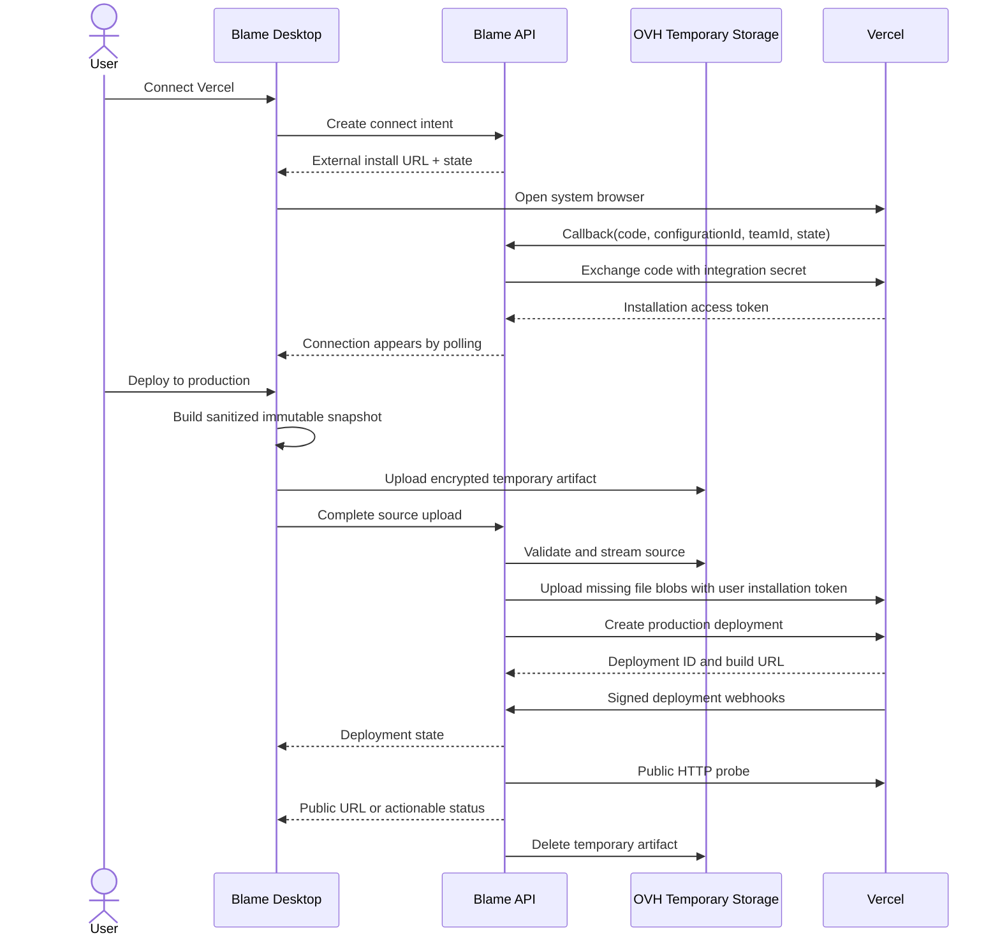

# Déploiement public sur le compte Vercel de l’utilisateur

**Statut :** spécification produit et technique proposée<br>
**Portée :** page `Deploy` de l’application Blame<br>
**Provider V1 :** Vercel<br>
**Décision :** faisable, avec un périmètre de compatibilité explicite<br>
**Date de référence :** 15 août 2026

## 1. Décision de faisabilité

La feature est réalisable sans utiliser le compte, le token de déploiement ou le projet Vercel de Blame.

Blame doit être enregistré comme **Vercel Connectable Account Integration** et utiliser l’**External Installation Flow**. L’utilisateur choisit dans Vercel le scope d’installation — compte personnel ou équipe — puis Vercel fournit à l’intégration un token attaché à cette installation. Les projets, déploiements, domaines par défaut, quotas et coûts Vercel appartiennent donc au scope choisi par l’utilisateur.

Le `client_id` et le `client_secret` de l’intégration Blame restent nécessaires pour échanger le code d’installation. Ils identifient l’application OAuth Blame, mais ne donnent pas accès au compte Vercel de Blame et ne doivent jamais être utilisés comme credentials de déploiement.

Le GO reste soumis à un canary réel décrit en section 22, car l’installation d’une intégration Vercel est aussi une dépendance opérationnelle externe. Aucune impossibilité d’architecture n’a cependant été identifiée.

### 1.1 Limite structurante

Le runtime de preview Blame et un déploiement Vercel de production sont deux produits différents :

- le `PreviewManifest` Blame décrit des conteneurs, des services, des commandes de développement, des bindings et éventuellement Docker Compose ;
- un déploiement Vercel attend du code source compatible avec son système de build, un framework reconnu, des fichiers statiques ou la Build Output API ;
- Vercel ne transforme pas un environnement Docker Compose arbitraire en site de production ;
- les Vercel Functions ne peuvent notamment pas servir de serveur WebSocket et ne remplacent pas une base de données, Redis, un worker permanent ou un service TCP persistant.

Les scripts et informations produits à l’initialisation sont donc réutilisables comme **signaux**, mais ne doivent jamais être envoyés tels quels comme configuration de production. La feature introduit un `DeploymentManifest` distinct et un preflight de compatibilité bloquant.

Sources Vercel de référence :

- [External Installation Flow et paramètres de callback](https://vercel.com/docs/integrations/create-integration/submit-integration)
- [Échange du code et scopes REST d’une intégration](https://vercel.com/docs/integrations/create-integration/vercel-api-integrations)
- [Création d’un déploiement par upload de fichiers](https://vercel.com/docs/deployments/overview)
- [Configuration des builds](https://vercel.com/docs/builds/configure-a-build)
- [Limites de la plateforme](https://vercel.com/docs/limits)

## 2. Objectif produit

Permettre à un utilisateur de publier le projet local actuellement ouvert dans Blame sur son propre compte Vercel avec un flux court :

1. connecter Vercel ;
2. confirmer ou choisir le projet Vercel cible ;
3. vérifier automatiquement la compatibilité et la source envoyée ;
4. cliquer sur **Deploy to production** ;
5. suivre les quelques étapes utiles ;
6. ouvrir l’URL publique lorsque le déploiement est prêt.

Dans cette spec, « déploiement automatique » signifie une orchestration one-click déclenchée par l’utilisateur. Le déploiement continu à chaque modification ou commit n’appartient pas à la V1.

## 3. Principes non négociables

1. **Compte utilisateur.** Chaque appel Vercel qui crée ou lit une ressource utilise le token de l’installation de l’utilisateur et le `teamId` associé lorsque la cible est une équipe.
2. **Aucun fallback Blame.** Une connexion absente, révoquée ou insuffisante ne doit jamais basculer sur les credentials Vercel utilisés par Blame pour ses propres Sandboxes.
3. **Token serveur uniquement.** Le token Vercel n’est jamais retourné au renderer, au preload ou au process principal Electron. Vercel recommande explicitement de ne pas exposer ce token côté client.
4. **Production explicite.** Le bouton principal crée un déploiement avec `target: "production"`. Une production existante ne doit pas être remplacée tant que le nouveau build n’est pas prêt.
5. **Pas de faux support.** Un projet Compose incompatible est bloqué avant upload avec une explication actionnable.
6. **Pas de secrets locaux.** Les fichiers `.env*`, credentials et dossiers sensibles sont exclus par une règle dure que `.vercelignore` ne peut pas inverser.
7. **Source courante.** Le snapshot inclut les modifications suivies et non suivies visibles dans le workspace au moment de la confirmation.
8. **Traçabilité.** Le déploiement persiste la révision Git, l’empreinte du workspace et le nombre d’éléments transférés, jamais leur contenu dans la télémétrie.
9. **Réversibilité.** Déconnecter Vercel ne supprime aucun projet, domaine ou déploiement déjà créé chez Vercel.

## 4. Périmètre V1

### Inclus

- installation externe Vercel sur un compte personnel ou une équipe ;
- prise en charge de plusieurs installations Vercel pour un même utilisateur Blame, avec au plus une installation par scope Vercel ;
- création d’un nouveau projet Vercel ou association explicite à un projet accessible existant ;
- déploiement de la copie de travail locale vers la production ;
- build distant par Vercel à partir des fichiers source ;
- détection des frameworks et racines de monorepo à partir de l’initialisation Blame et des fichiers du projet ;
- statut temps réel raisonnable, logs de build à la demande, annulation et historique récent ;
- URL `*.vercel.app`, ouverture externe et copie ;
- détection post-déploiement d’une URL publique, protégée ou en erreur ;
- gestion des connexions révoquées, désinstallées, désactivées ou dont les permissions ont changé.

### Hors périmètre

- héberger le site sur une ressource Vercel appartenant à Blame ;
- accepter un Personal Access Token copié-collé ;
- déployer Docker Compose, une Vercel Sandbox ou un conteneur OCI comme production ;
- provisionner une base de données, Redis, une queue, un bucket ou un autre service tiers ;
- éditer ou importer automatiquement des variables d’environnement locales ;
- domaines personnalisés, DNS et certificats ;
- promotion Preview → Production, rollback et alias manuels ;
- connexion Git Vercel, auto-deploy sur push et webhooks Git ;
- déploiement de plusieurs sites Vercel à partir d’un seul projet Blame ;
- providers autres que Vercel.

## 5. Sémantique de « public »

Un déploiement n’est affiché **Public** que lorsque les deux conditions suivantes sont vraies :

1. Vercel annonce le déploiement `READY` et lui a assigné son alias de production ;
2. un probe HTTP non authentifié vers l’URL canonique reçoit une réponse `2xx` ou une redirection publique valide.

Résultats possibles :

| État UI     | Signification                                                     |
| ----------- | ----------------------------------------------------------------- |
| `Public`    | build prêt et URL accessible sans authentification                |
| `Protected` | Vercel est prêt, mais le probe reçoit `401` ou `403`              |
| `Unhealthy` | Vercel est prêt, mais la racine répond en erreur ou ne répond pas |
| `Building`  | upload accepté, build Vercel en cours                             |
| `Failed`    | upload, configuration ou build en erreur                          |

Blame ne désactive jamais automatiquement la Deployment Protection d’un projet existant. L’interface renvoie vers les réglages Vercel lorsque la production est protégée.

Le champ `public` de `vercel.json` ne doit pas être utilisé pour rendre le site accessible : chez Vercel, ce champ rend les vues source et logs publiques. Blame ne le génère ni ne le modifie.

## 6. Expérience de la page Deploy

L’application actuelle utilise des libellés anglais. La page suit cette convention, reste centrée sur une colonne `max-w-3xl` et réutilise les composants `Card`, `Badge`, `Alert`, `Button`, `Dialog`, `Skeleton` et `Tooltip` existants.

### 6.1 État non connecté

Le placeholder `/deploy` est remplacé par un empty state cohérent avec `SecurityPage` :

- icône Vercel dans un carré arrondi ;
- titre `Deploy your site` ;
- sous-titre `Publish this project with Vercel.` ;
- bouton principal `Connect Vercel` ;
- note courte `Deployments and usage stay in your Vercel account.`

Le bouton ouvre le navigateur système sur l’External Installation Flow. La page reste en attente pendant cinq minutes et rafraîchit la liste des connexions. Aucun token ou code OAuth ne transite par l’UI.

### 6.2 État connecté, jamais déployé

La page affiche :

- le scope Vercel actif, par exemple `Personal · alex` ou `Team · Acme` ;
- un badge `Connected` ;
- une carte principale `Production` avec l’état `Not deployed` ;
- le projet cible proposé, créé par défaut à partir du nom du projet Blame ;
- la racine et le framework détectés sur une seule ligne secondaire ;
- un bouton `Deploy to production` ;
- un lien discret `Change project`.

Blame ne relie jamais silencieusement un projet Vercel existant sur la seule égalité de nom. En cas de collision, l’utilisateur choisit entre le projet existant et un nouveau nom disponible.

### 6.3 Confirmation de production

Un dialogue compact précède chaque upload :

> **Deploy to production?**<br>
> Blame will send 184 files (2.8 MB) from the current workspace to Vercel. 3 uncommitted changes are included. Local secrets are excluded.

Actions : `Cancel` et `Deploy`.

Si le workspace change entre le preflight et la construction de l’archive, l’opération est arrêtée et le dialogue est recalculé. Blame ne déploie jamais une source différente de celle confirmée.

### 6.4 Déploiement en cours

La carte principale conserve un seul indicateur de progression et quatre étapes lisibles :

1. `Preparing files`
2. `Uploading to Vercel`
3. `Building on Vercel`
4. `Checking public URL`

Le détail des logs reste replié derrière `View build logs`. Un bouton `Cancel deployment` est disponible tant que Vercel accepte l’annulation.

### 6.5 Production en ligne

La carte affiche :

- badge `Public` vert, `Protected` ambre ou `Unhealthy` rouge ;
- URL canonique avec boutons `Open site` et copie ;
- `Deployed 2 minutes ago · main · 3 local changes` ;
- bouton principal `Deploy update` ;
- lien `Open in Vercel`.

Une liste compacte montre au plus cinq déploiements récents avec état, date, révision courte et accès aux logs. Aucun dashboard dense n’est nécessaire.

### 6.6 Erreurs et incompatibilités

Une erreur affiche un résumé produit, puis une action :

- `Reconnect Vercel` pour un token révoqué ;
- `Manage access in Vercel` pour un scope insuffisant ;
- `Configure environment in Vercel` pour une configuration externe manquante ;
- `View build logs` pour un échec de build ;
- `Run project initialization again` si le contrat local est absent ou ambigu.

Les erreurs provider brutes, tokens, IDs sensibles et stacks backend ne sont jamais rendus.

### 6.7 Wireframe indicatif

```text
Deploy

┌──────────────────────────────────────────────────────────┐
│ ▲  Production                              [Public]      │
│    https://my-site.vercel.app              Open site  ⧉ │
│                                                          │
│    Acme · my-site · Vite · apps/web                     │
│    main · 3 local changes · deployed 2 minutes ago      │
│                                                          │
│                                      [ Deploy update ]   │
└──────────────────────────────────────────────────────────┘

Recent deployments                                      View all
✓ Public    a13fd21 + local changes                 2 min ago
× Failed    92ca771                                  1 day ago

Vercel team: Acme                         Manage connection
```

## 7. Connexion Vercel

Vercel recommande désormais l’External Installation Flow plutôt qu’un ancien flux OAuth2 autonome. Le token reste obtenu par l’échange OAuth du code court.

### 7.1 Flux

1. Le renderer demande un connect intent authentifié au backend Blame.
2. Le backend crée un `state` aléatoire, à usage unique, lié à l’utilisateur et valable dix minutes.
3. Le process desktop ouvre `https://vercel.com/integrations/<slug>/new?state=<state>` dans le navigateur système.
4. L’utilisateur choisit son compte personnel ou son équipe et les accès projet dans Vercel.
5. Vercel appelle le redirect URL Blame avec `code`, `configurationId`, `teamId`, `next`, `source=external` et `state`.
6. Le backend valide et consomme `state`, puis échange immédiatement le code via `POST /v2/oauth/access_token` avec le client secret Blame.
7. Le token reçu est chiffré et associé au `configurationId` et au scope.
8. Le backend redirige uniquement vers la valeur Vercel `next` validée.
9. La page desktop détecte la nouvelle connexion par polling authentifié et continue sans deep link.

Le callback doit rester idempotent : un `configurationId` déjà connu met à jour ses métadonnées, sans créer une seconde connexion.

### 7.2 Scopes minimaux

| Scope Vercel                | Niveau     | Usage V1                                             |
| --------------------------- | ---------- | ---------------------------------------------------- |
| `deployment`                | Read/Write | créer, lire, journaliser et annuler les déploiements |
| `project`                   | Read/Write | lister, créer, associer et lire les projets          |
| `integration-configuration` | Read       | vérifier l’installation et ses accès                 |
| `team`                      | Read       | afficher le scope équipe sélectionné                 |
| `user`                      | Read       | afficher le compte personnel sélectionné             |

Ne pas demander en V1 : `domain`, `project-env-vars`, `global-project-env-vars`, `billing`, `log-drain`, `edge-config` ou `security`.

La suppression distante de l’installation reste pilotée par Vercel. Si Blame souhaite proposer `Disconnect and uninstall`, il faudra faire passer `integration-configuration` en Read/Write et expliquer que l’action affecte tous les projets Blame liés à cette installation. La V1 propose seulement `Manage connection in Vercel` et un unlink local.

### 7.3 Cycle de vie

- `active` : API utilisable ;
- `disabled` : Vercel refuse les appels, par exemple si l’installateur a quitté l’équipe ;
- `permission_pending` : nouveaux scopes pas encore confirmés ;
- `removed` : webhook `integration-configuration.removed` reçu ;
- `invalid` : authentification ou métadonnées incohérentes.

Une connexion non active n’est jamais utilisée pour une nouvelle opération.

## 8. Contrat de déploiement

Le `PreviewManifest` reste exclusivement orienté preview. Un nouveau package conseillé, `@blame/deploy-contract`, porte un contrat strict sans dépendance à Vercel SDK.

```ts
type DeploymentManifest = {
  provider: "vercel";
  rootDirectory: string;
  framework: string | null;
  installCommand?: string;
  buildCommand?: string;
  outputDirectory?: string;
  runConfigurationId?: string;
  previewServiceId?: string;
  requiredEnvironmentKeys: string[];
  compatibility: {
    status: "supported" | "conditional" | "unsupported";
    blockers: DeploymentDiagnostic[];
    warnings: DeploymentDiagnostic[];
  };
};
```

Le contrat est strict, borné et parsé côté desktop et backend. Les chemins doivent rester relatifs au workspace. Les commandes ne contiennent ni retour à la ligne, redirection de secret, substitution non bornée ni commande de serveur longue durée.

### 8.1 Priorité de configuration

1. `vercel.json` ou `vercel.ts` présent dans le projet, sans le modifier ;
2. choix explicite déjà validé et persisté pour la target Blame ;
3. `DeploymentManifest` issu de l’initialisation ;
4. autodétection Vercel lorsque `framework` vaut `null`.

Une valeur explicite dans le repository prévaut sur une suggestion de l’agent. Le preflight signale les contradictions plutôt que de les réécrire.

### 8.2 Réutilisation de l’initialisation existante

Les données suivantes sont réutilisées :

- `previewManifest.project.root` pour proposer la racine ;
- `detectedStack` pour proposer le framework ;
- le service `kind: "preview"` et son endpoint HTTP pour identifier la surface web ;
- `runConfigurations` de catégorie `web` pour lever les ambiguïtés de monorepo ;
- `scopes` pour connaître les fichiers utiles ;
- les bindings et noms de variables pour produire `requiredEnvironmentKeys` ;
- les manifests et lockfiles détectés pendant l’analyse pour déterminer le package manager et le build script.

Ne sont pas réutilisés comme commandes de production :

- `setupScript` ;
- `dockerCompose` ;
- les commandes `dev`, `serve`, `watch` ou un process persistant ;
- les images Docker de services de dépendance ;
- les URLs et ports de preview.

Pour les projets déjà initialisés avant l’ajout du `DeploymentManifest`, Blame tente une dérivation déterministe à partir du snapshot d’initialisation et des fichiers actuels. Si la racine ou le service primaire reste ambigu, le déploiement est bloqué et l’utilisateur est invité à relancer l’initialisation.

## 9. Matrice de compatibilité

### `supported`

- site HTML/CSS/JS statique ;
- framework officiellement pris en charge par Vercel avec build source standard ;
- application utilisant des Vercel Functions compatibles ;
- monorepo avec une racine web unique et explicite ;
- dépendances externes accessibles par variables d’environnement Vercel.

### `conditional`

- variables d’environnement requises dont Blame ne peut pas confirmer la présence ;
- `vercel.ts` programmable ;
- dépendances réseau externes ;
- configuration de build personnalisée ;
- plusieurs candidats web, mais un choix utilisateur persistant permet de lever l’ambiguïté ;
- protection de déploiement ou plan Vercel pouvant limiter l’accès public.

Un état `conditional` autorise le déploiement après une confirmation concise et n’importe jamais les valeurs de `.env`.

### `unsupported`

- aucun endpoint web ;
- application mobile, desktop ou terminal sans site associé ;
- Dockerfile ou image OCI comme seule recette exécutable ;
- base de données, Redis, queue ou service TCP local requis au runtime ;
- worker permanent requis ;
- serveur WebSocket requis ;
- plusieurs sites de production sans cible unique ;
- build nécessitant Docker Compose, accès root ou daemon système ;
- symlink sortant du workspace ;
- source dépassant les limites de fichiers ou de taille ;
- `PreviewManifest` invalide ou initialisation incomplète.

Les diagnostics utilisent des codes stables, par exemple `DEPLOY_WEBSOCKET_UNSUPPORTED`, `DEPLOY_LOCAL_DATABASE_REQUIRED`, `DEPLOY_ROOT_AMBIGUOUS` et `DEPLOY_SOURCE_TOO_LARGE`.

## 10. Préparation de la source

### 10.1 Snapshot

Le process principal Electron, seul composant autorisé à lire arbitrairement le workspace local, construit un snapshot déterministe :

- commit `HEAD`, branche et état detached éventuel ;
- hash du contenu suivi et non suivi inclus ;
- liste triée des fichiers, SHA-256, mode et taille ;
- nombre de modifications locales ;
- racine de déploiement et empreinte du `DeploymentManifest`.

Le renderer ne reçoit que les métadonnées nécessaires à la confirmation.

### 10.2 Exclusions

Trois couches sont appliquées dans cet ordre :

1. exclusions de sécurité Blame, non réversibles ;
2. exclusions par défaut compatibles avec Vercel ;
3. `.vercelignore` du repository.

Exclusions de sécurité minimales :

- `.git`, `.ssh`, `.blame`, credentials cloud et configurations de clients ;
- `.env`, `.env.*` et variantes locales, sauf fichiers d’exemple sans valeur secrète ;
- `.npmrc`, `.pypirc`, clés SSH, certificats privés et fichiers de token connus ;
- socket, device, FIFO et symlink sortant du workspace ;
- `node_modules` et caches de package managers ;
- archives et logs générés par Blame.

Avant confirmation, un scanner déterministe de secrets inspecte les noms et un ensemble borné de motifs. Un finding à haute confiance bloque l’upload ; un warning faible est affiché sans révéler la valeur.

`.vercelignore` est respecté pour les exclusions supplémentaires, mais ne peut pas réinclure un chemin interdit par Blame. La documentation Vercel confirme que ce fichier est le mécanisme prévu pour empêcher l’upload de fichiers privés : [Exclude Files from Deployments](https://vercel.com/docs/deployments/vercel-ignore).

### 10.3 Limites V1

- maximum conservateur de 15 000 fichiers ;
- maximum Blame de 256 MiB non compressés ;
- maximum effectif égal au minimum entre la limite Blame et la limite confirmée pour le plan Vercel ;
- sur Hobby, appliquer au plus 100 MB tant qu’un canary REST n’a pas démontré une autre limite ;
- build distant limité par Vercel à 45 minutes.

Les seuils de 15 000 fichiers et 100 MB/1 GB sont documentés par Vercel pour les déploiements CLI. La phase 0 doit confirmer leur comportement sur le workflow REST Files retenu ici. La V1 garde les valeurs conservatrices tant que ce contrat n’est pas prouvé. Les limites connues sont affichées avant l’upload, pas découvertes après plusieurs minutes de transfert.

## 11. Transit de la source

Vercel demande que le token d’intégration ne soit jamais exposé côté client. L’upload direct desktop → Vercel n’est donc pas retenu.

Le flux V1 est :

1. le desktop produit une archive source assainie ;
2. il l’envoie vers un objet temporaire OVH via URL signée, comme le flux d’artefacts de preview existant ;
3. un worker Blame valide intégrité, chemins, limites et inventaire ;
4. le worker envoie chaque blob manquant à l’API Files Vercel avec le token chiffré de l’installation ;
5. il appelle l’API Create Deployment avec les références SHA ;
6. l’objet OVH est supprimé dès que Vercel a accepté le déploiement ;
7. un reaper supprime tout objet orphelin après 24 heures au plus.

L’objet est chiffré au repos, n’est jamais monté dans le runtime applicatif Blame et n’est pas conservé comme sauvegarde. L’UI de confirmation doit pouvoir ouvrir un détail court :

> Source files transit temporarily through Blame so your Vercel token stays server-side. They are deleted after Vercel accepts the deployment.

Cette architecture signifie que Blame orchestre le transfert, mais le site final, son exécution et sa facturation restent exclusivement sur le compte Vercel de l’utilisateur.

## 12. Orchestration Vercel

Le backend implémente un adapter Vercel isolé. Les versions d’endpoint sont centralisées et validées contre l’OpenAPI officielle au moment de l’implémentation.

Opérations requises :

- échange du code OAuth ;
- lecture de l’utilisateur ou de l’équipe ;
- liste paginée des projets accessibles ;
- création ou lecture du projet cible ;
- upload content-addressed des fichiers ;
- création d’un déploiement de production ;
- lecture du déploiement et de ses événements de build ;
- annulation du déploiement ;
- lecture des alias nécessaires à l’URL canonique.

Le workflow Files officiel est SHA-centré : calculer un digest, uploader les blobs, puis créer le déploiement avec leurs références. Voir [Deploying to Vercel](https://vercel.com/docs/deployments/overview) et [génération des SHA pour l’API](https://vercel.com/kb/guide/how-do-i-generate-an-sha-for-uploading-a-file-to-the-vercel-api).

### 12.1 Création de projet

Par défaut, le premier déploiement crée un projet Vercel distinct. Le nom est normalisé depuis le projet Blame et sa disponibilité est vérifiée.

Pour un projet existant :

- il doit apparaître dans la liste paginée retournée par le token d’installation ;
- le choix est explicite ;
- Blame affiche que la prochaine production de ce projet sera modifiée ;
- le lien est persisté avant l’upload ;
- un changement ultérieur de cible demande confirmation.

### 12.2 Build

Blame envoie les fichiers source et laisse Vercel exécuter le build distant afin de conserver :

- l’autodétection de framework ;
- les variables d’environnement du projet Vercel ;
- les System Environment Variables ;
- le cache de build ;
- le comportement officiel des frameworks.

La V1 n’utilise pas `vercel build --prebuilt`, car un build local manquerait de certaines variables système et demanderait d’exposer le token ou de reproduire une partie du runtime Vercel.

## 13. Diagramme de séquence



## 14. États persistés

### 14.1 Opération Blame

```text
preflighting
  -> awaiting_confirmation
  -> packaging
  -> uploading_source
  -> transferring_to_vercel
  -> submitted
  -> building
  -> verifying_public_access
  -> ready | protected | unhealthy

Tout état actif -> canceling -> canceled
Tout état actif -> failed
```

`ready`, `protected`, `unhealthy`, `failed` et `canceled` sont terminaux.

### 14.2 Mapping provider

Le mapping des états Vercel reste dans l’adapter. L’UI ne dépend pas directement des strings provider. Un statut provider inconnu produit `building` pendant une fenêtre bornée, puis une erreur de contrat observable, jamais un succès optimiste.

## 15. Modèle de données

### `vercel_connections`

- `id` UUIDv7 ;
- `user_id` ;
- `configuration_id` unique ;
- `scope_type` : `personal | team` ;
- `team_id` nullable ;
- `scope_display_name` ;
- `encrypted_access_token` non sérialisable ;
- `status` ;
- `last_validated_at` ;
- `created_at`, `updated_at`, `removed_at`.

### `vercel_connect_intents`

- `id` UUIDv7 ;
- `user_id` ;
- `state_hash` unique ;
- `expires_at` ;
- `consumed_at` nullable.

Le `state` brut n’est pas persisté.

### `project_deploy_targets`

- `id` UUIDv7 ;
- `project_id` unique en V1 ;
- `vercel_connection_id` ;
- `vercel_project_id` ;
- `vercel_project_name` ;
- `root_directory` ;
- `framework` nullable ;
- `production_url` nullable ;
- `deployment_manifest` JSON validé ;
- timestamps.

### `project_deployments`

- `id` UUIDv7 ;
- `project_id`, `target_id`, `vercel_connection_id` ;
- `operation_id` unique pour l’idempotence ;
- `provider_deployment_id` nullable et unique par connexion ;
- `source_revision`, `source_branch`, `workspace_hash` ;
- `local_change_count`, `file_count`, `source_bytes` ;
- `status`, `provider_state` nullable ;
- `deployment_url`, `production_url` nullable ;
- `error_code`, `safe_error_message` nullable ;
- `provider_request_id` nullable ;
- `created_at`, `submitted_at`, `ready_at`, `updated_at`.

### `deployment_source_artifacts`

- métadonnées de l’objet temporaire ;
- SHA-256 et taille ;
- statut `uploading | durable | transferring | deleted | invalid` ;
- `expires_at` obligatoire ;
- aucune relation durable avec un fichier source individuel.

Les credentials Vercel ne doivent pas réutiliser `provider_credentials`, qui appartient aux modèles IA et possède actuellement des flux de résolution vers l’agent. Un modèle séparé réduit le risque d’exposition accidentelle.

## 16. API Blame proposée

### Connexions

- `POST /api/v1/integrations/vercel/connect-intents`
- `GET /api/v1/integrations/vercel/callback` — public, state obligatoire
- `GET /api/v1/integrations/vercel/connections`
- `GET /api/v1/integrations/vercel/connections/:id/projects?cursor=...`
- `DELETE /api/v1/integrations/vercel/connections/:id/link` — unlink local seulement
- `POST /api/v1/webhooks/vercel` — public, signature obligatoire

### Target et preflight

- `GET /api/v1/projects/:projectId/deploy-target`
- `PUT /api/v1/projects/:projectId/deploy-target`
- `POST /api/v1/projects/:projectId/deployments/preflight`

### Déploiements

- `POST /api/v1/projects/:projectId/deployments` — crée l’opération et une cible d’upload
- `POST /api/v1/projects/:projectId/deployments/:id/source/complete`
- `GET /api/v1/projects/:projectId/deployments?cursor=...`
- `GET /api/v1/projects/:projectId/deployments/:id`
- `GET /api/v1/projects/:projectId/deployments/:id/logs?cursor=...`
- `POST /api/v1/projects/:projectId/deployments/:id/cancel`

Toutes les routes, hors callback et webhook, exigent auth, licence et ownership du projet. Le backend recalcule les relations `user → project → target → connection` ; il ne fait jamais confiance aux IDs assemblés par le client.

## 17. Bridge desktop proposé

Un client `deploy` est ajouté à `Platform`, au preload et au main process. Le renderer ne fait que piloter l’expérience.

Responsabilités du main process :

- analyser le workspace et produire le preflight local ;
- construire l’archive assainie ;
- vérifier que le snapshot n’a pas changé ;
- uploader vers la cible signée ;
- relayer progression et annulation ;
- ouvrir les URLs externes validées.

Responsabilités du renderer :

- choisir connexion et target ;
- afficher compatibilité et confirmation ;
- déclencher l’opération avec un `operationId` UUID ;
- suivre l’état backend ;
- afficher uniquement des erreurs sûres.

Comme pour les autres bridges desktop, seuls les `webContents` de la fenêtre principale sont autorisés par les handlers IPC.

## 18. Idempotence, concurrence et reprise

- un `operationId` identifie toute tentative depuis le clic jusqu’au provider ;
- un seul déploiement actif est autorisé par `project_deploy_target` ;
- un second clic retourne l’opération existante au lieu de créer un doublon ;
- l’upload content-addressed peut être repris sans réenvoyer les blobs déjà présents chez Vercel ;
- après timeout de création, le worker recherche le déploiement par métadonnée/idempotency avant de retenter ;
- le statut est alimenté par webhook et réconcilié par polling provider ;
- un worker bloqué possède un lease borné et récupérable ;
- un échec avant soumission supprime l’artefact temporaire ;
- un échec de build laisse la production précédente intacte.

Le webhook est un signal, pas une autorité d’ownership. Chaque événement est dédupliqué et relié à un `provider_deployment_id` déjà connu.

## 19. Sécurité et confidentialité

### OAuth et tokens

- `state` aléatoire d’au moins 256 bits, hashé au repos, TTL dix minutes et consommation atomique ;
- callback URI exacte ;
- `code` échangé une seule fois et jamais loggé ;
- `next` accepté uniquement comme URL HTTPS Vercel attendue ;
- token chiffré avec le service d’encryption Adonis et compatible rotation de clé ;
- token exclu des serializers, exports de compte, erreurs, télémétrie et logs ;
- `teamId` ajouté à chaque appel pour une installation équipe ;
- aucun token renvoyé à Electron, même temporairement.

Vercel indique explicitement qu’un token d’intégration donne accès au compte ou à l’équipe et ne doit pas être exposé côté client : [Building Integrations with Vercel REST API](https://vercel.com/docs/integrations/create-integration/vercel-api-integrations).

### Webhooks

- lire le body brut avant parsing ;
- vérifier `x-vercel-signature` en HMAC-SHA1 avec l’Integration Secret ;
- comparaison constant-time ;
- limite de taille ;
- déduplication ;
- réponse `2xx` rapide puis traitement asynchrone.

Référence : [Securing Vercel Webhooks](https://vercel.com/docs/webhooks/webhooks-api).

### Source

- consentement explicite à chaque production ;
- archive déterministe et validée avant et après transfert ;
- protection path traversal, collision de casse, bombe de décompression et symlink ;
- chiffrement en transit et au repos ;
- suppression rapide et reaper ;
- aucune valeur de variable d’environnement locale ;
- aucune exécution du code utilisateur dans l’API Blame pendant l’upload ;
- appels provider limités à `https://api.vercel.com` ;
- probe public limité aux URLs retournées par le provider, avec protection SSRF et redirections bornées.

### Permissions provider

L’accès projet choisi dans Vercel peut être restreint. Un `403` ne déclenche aucune escalade automatique ; l’utilisateur est dirigé vers `Manage access in Vercel`.

## 20. Observabilité

Événements produit :

- `deploy.vercel.connect.started|completed|failed` ;
- `deploy.preflight.completed` avec statut et codes de diagnostic ;
- `deploy.source.packaged|uploaded|deleted` ;
- `deploy.submitted|ready|protected|unhealthy|failed|canceled`.

Attributs autorisés :

- durée, statut, plan/scope catégorisé ;
- compteurs et tailles bucketisées ;
- framework normalisé ;
- présence de changements locaux ;
- code d’erreur interne ou provider allowlisté.

Attributs interdits :

- token, code OAuth, state brut ;
- contenu ou chemin de fichier ;
- variable d’environnement ou secret ;
- logs de build bruts ;
- URL complète, nom de domaine personnalisé, nom de compte ou d’équipe ;
- payload webhook brut.

Les logs opérationnels peuvent contenir les UUID Blame et le request ID Vercel, mais passent par le redactor de secrets existant.

## 21. Stratégie de tests

### Unitaires

- parser et normalisation du `DeploymentManifest` ;
- matrice de compatibilité ;
- priorité `vercel.json` / target / initialisation / auto ;
- filtres `.vercelignore` et exclusions non réversibles ;
- snapshot déterministe, collision de casse et symlink ;
- changement du workspace entre preflight et upload ;
- machine d’état et mapping provider ;
- génération/consommation du state OAuth ;
- chiffrement et redaction du token ;
- validation HMAC constant-time ;
- idempotence et concurrence.

### Fonctionnels API

- callback valide, expiré, rejoué et mauvais state ;
- installation personnelle et équipe avec `teamId` ;
- pagination des projets ;
- ownership croisé refusé ;
- permission insuffisante ;
- webhook dupliqué, invalide et désinstallation ;
- artefact corrompu ou trop volumineux ;
- reprise après timeout provider ;
- annulation et maintien de la production précédente ;
- suppression de compte sans suppression des projets Vercel.

### Desktop

- contrat preload sans exposition de token ;
- validation de l’émetteur IPC ;
- packaging macOS, Windows et Linux ;
- projet propre, dirty et avec fichiers non suivis ;
- monorepo ;
- secrets exclus ;
- progression, annulation et reprise après redémarrage de l’application.

### Canaries Vercel

- site statique minimal ;
- Vite ;
- Next.js avec route serveur ;
- compte personnel Hobby ;
- équipe Pro ;
- accès à tous les projets puis accès limité ;
- nouveau projet puis projet existant ;
- build en échec et logs ;
- production protégée ;
- désinstallation et réinstallation.

## 22. Phase 0 obligatoire — canary provider

Avant de démarrer l’implémentation produit complète :

1. créer l’intégration connectable Blame dans la Vercel Integrations Console ;
2. configurer redirect URL, webhook URL, URLs légales et scopes minimaux ;
3. tester l’External Installation Flow sur un compte personnel et une équipe ;
4. prouver que le token obtenu peut lister et créer les projets attendus selon les accès choisis ;
5. uploader un site statique inerte via le workflow SHA/Files ;
6. créer explicitement un déploiement `production` ;
7. vérifier alias, URL publique, logs, annulation et webhooks ;
8. désinstaller l’intégration et constater l’invalidation du token ;
9. documenter les versions exactes d’endpoints et les payloads dans des tests de contrat.

### Critère Go/No-Go

**GO** si une installation externe limitée au scope choisi peut créer ou utiliser un projet et y créer une production sans credential Vercel Blame.

**NO-GO** si Vercel impose pour ces opérations un token personnel manuel, un token appartenant au compte Blame, l’exposition du token au client ou l’accès global non maîtrisable au compte utilisateur.

Un écart sur la création de nouveau projet avec accès restreint ne bloque pas toute la feature : la V1 peut exiger l’association à un projet autorisé. En revanche, ce comportement doit être connu avant de figer l’UX.

## 23. Découpage d’implémentation ultérieur

1. `@blame/deploy-contract` et analyse de compatibilité ;
2. modèles, migrations et adapter Vercel backend ;
3. External Installation Flow, chiffrement et webhooks ;
4. target Vercel et listing paginé ;
5. packager desktop sécurisé et artefacts temporaires ;
6. worker Files/Create Deployment et réconciliation ;
7. page Deploy et états UI ;
8. logs, annulation et probe public ;
9. canaries, hardening et rollout progressif.

Chaque lot doit rester testable sans muter un vrai compte Vercel, sauf la suite canary explicitement isolée.

## 24. Critères d’acceptation

La V1 est terminée lorsque :

1. un utilisateur connecte un compte personnel ou une équipe Vercel sans copier de token ;
2. le token ne quitte jamais le backend Blame et aucun credential de déploiement Blame n’est utilisé ;
3. l’utilisateur crée ou choisit explicitement un projet Vercel qui lui appartient ;
4. un projet statique, Vite et Next.js compatibles sont publiés depuis le workspace courant ;
5. les changements non commités annoncés sont bien inclus ;
6. les fichiers secrets et interdits ne sont jamais envoyés ;
7. un projet Compose incompatible est bloqué avant transfert avec un diagnostic clair ;
8. le statut survit au redémarrage de l’application ;
9. un build réussi expose une URL vérifiée et ouvrable ;
10. une production protégée n’est pas présentée comme publique ;
11. un build échoué conserve la production précédente et expose des logs sûrs ;
12. une désinstallation Vercel rend la connexion inutilisable sans supprimer les sites ;
13. les artefacts temporaires sont supprimés et couverts par un reaper ;
14. les limites, erreurs de permission, webhooks et appels provider sont testés ;
15. l’interface reste utilisable sans afficher le détail technique par défaut.

## 25. Conclusion

La bonne architecture n’est ni « Blame héberge pour l’utilisateur », ni « Blame lance le Docker Compose de preview en production ».

Blame agit comme un orchestrateur : il transforme l’initialisation en contrat de déploiement compatible, prépare une source sûre, utilise le token de l’installation Vercel choisie par l’utilisateur, déclenche la production dans son projet et restitue un état minimal et fiable.

Cette séparation préserve la promesse essentielle : **le site, le projet, l’usage et la facture Vercel appartiennent à l’utilisateur**.
